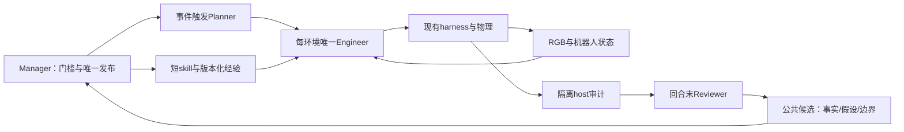

# RSI 架构审阅：保留闭环，压缩入口，分离成绩与经验

证据快照：**2026-09-16 08:28:21 UTC**。本次只读审阅、离线候选与测试；未运行模型、API、训练或仿真，未改在线共享文件。两条桌面对话使用父任务提供的[公开消息摘录](source-thread-messages.json)，没有唤醒、resume 或读取私有推理。R020 既有评审复用，历史“推门0/API0”不作为当前事实。所有源文件与回执 SHA256 见 [source-manifest.json](source-manifest.json)；下述行号对应该快照。

## 成绩与限定

- **桌面抓块10次**：15次有物理动作的学习尝试，438个已结束记录中423个仅基础设施记录。成功 ID：0003、0004、0005、0006、0007、0432、0433、0435、0437、0438。5次回合末仍满足保持条件；其余5次曾满足原生升高/保持标准，不能改写成始终抓牢。保留10次已审计成功，不用较严的终态口径倒扣历史成绩。固定场景独立新建后端；旧回执没有现代 reset UUID，未补造。[原审计](../R018/audit_summary.json)、[0437原回执](../R018/campaign/episode-0437/result.json)、[新建后端代码](/home/galbot/lizekai/RSI/tools/codex_direct_sim.py:77)。
- **SIMPLE推门5/10次目标**：14次已完成物理回合，成功0010–0014；较用户的“两次”快照新增3次。成功具备不同 reset UUID/进程、完整turn、技能更新、录像与审计；不是回放。原生 CloseDoor 被明确改为闭门推开，使用 `asset003-exact-frame-four-boxes-v1` 固定门框碰撞修复；原资产文件未改，初始朝向/站位有差别。不能称原样基准或同一初态的因果对照。0011终态47.81°、连续2.70秒；其余逐项见[状态证据](status-evidence.json)。分母含1次预算截断、8次主动提前结束，不能统称9次物理失败。
- **SIMPLE抓盒1次**：0006，6次已结束物理回合。末段原生阈值2.54秒，末17.3秒无桌面/其他支撑；没有另做全高终态hold动作。不把一次成功说成泛化或迁移已成立。[原审计](../R019/bendpick-campaign/episode-0006/success_review.json)。
- **苹果0、水龙头0、放盒0**：快照分别有0007、0007、0003未完成。苹果6次已结束均属提前结束，且人工反馈暴露需读单列审查；水龙头5次有动作/6个结束记录，包含基础设施问题；放盒0001/0002原生接触触发被任务审计否决。H001三次纠正诊断单列，不计正式成功。API地面搬运首批为6调用/3动作、预算截断、human_feedback_used=true，未抓起；批准120调用的后续批次由独立工程师持有，本评审不推断其执行成绩。

全部物理成绩为 **MuJoCo**（SIMPLE为checkpoint PD + ScaleBFM UMI-4），非Isaac执行；推理时暂停物理，非实时闭环。这里只报告学习成功；没有冻结留出评测、布局泛化或角色收益证据。已检查所有计数成功的原回执、turn完成状态、视频元数据，并重算SIMPLE成功审计列出的文件哈希；未重跑物理或逐帧观看所有视频。

## 按影响排序的发现

### 1. 成功信号仍有两种口径，检索会偏向未经任务审计的“成功”

**已正确修复的部分**：放盒runner改用 `episode_status(...).audited_task_success` 给成绩，独立保存原生计数；新放盒变体使用显式 staged-placement 合同，最终几何仍需审查。[learn_simple_task.py:80](/home/galbot/lizekai/RSI/tools/learn_simple_task.py:80)、[simple_placement.py:5](/home/galbot/lizekai/RSI/rsi/simple_placement.py:5)、[审计分类:32](/home/galbot/lizekai/RSI/tools/audit_simple_campaigns.py:32)。不重复实现。

**剩余缺口**：`SkillMemory.read` 持续优先置顶最早 `native_outcome=='success'`；写入来自evaluator当时结果，不等待任务审计；门runner成绩仍直接sum原生result。[skill_learning.py:35](/home/galbot/lizekai/RSI/rsi/skill_learning.py:35)、[learn_grasp_skill.py:162](/home/galbot/lizekai/RSI/tools/learn_grasp_skill.py:162)、[learn_door_skill.py:51](/home/galbot/lizekai/RSI/tools/learn_door_skill.py:51)。这不证明当前门计数错误——本次5次均通过独立审计——但放盒反例说明原生“成功”不能当优先检索质量标签。

建议发布者把原始outcome保持不变，单独维护经过公开材料审阅的检索选择；任务审计失败的来源仍可作为反例。actor只取可见事实、公开轨迹和适用限制，不复制host接触/物体位姿/奖励或把其改写成视觉事实。本次短入口明确native标签不是任务验证，但**没有宣称修复了该自动排序缺口**。参考RoboRSI task wiki的观察/假设/归档分离，避免把manager批准假设等同物理事实。[task_wiki.py:267](/home/galbot/lizekai/RSI/ref/RoboRSI/roborsi/agents/task_wiki.py:267)。

### 2. 实际actor指令超长：已提供一个未合并的最小修复

`SkillMemory.update`与`prepare_hybrid_skill`只检查技能正文；caller再追加1962字符固定运行合同。[skill_learning.py:51](/home/galbot/lizekai/RSI/rsi/skill_learning.py:51)、[skill_transfer.py:58](/home/galbot/lizekai/RSI/rsi/skill_transfer.py:58)、[learn_grasp_skill.py:274](/home/galbot/lizekai/RSI/tools/learn_grasp_skill.py:274)。实际 `developer_instructions=prompt+immutable` 没有总长校验。取样时Direct总长1012 words/7913字符，SIMPLE936/7980，尽管各自单文件通过。

[复现](checks/before-reproduction.json)先于补丁；[候选补丁](CANDIDATE/combined-instruction-cap.patch)复用现有skill_size，在创建episode、host、transport前检查组合，且自动更新必须预留同一runtime长度。无效更新不会写journal、版本或技能。固定runtime原文不变，故提前结束与异常保护不被覆盖。[短入口](CANDIDATE/loco-manip-direct/SKILL.md)把数字动作史留在既有版本/公开trajectory，组合为738 words/5523字符/4773非空白，三项上限均通过；8项针对回归通过，技能校验通过。

这是**一个完整改进：总长合同+可用短入口**，不是新框架。未合并、未物理验证；发布者必须先压缩每个将使用此caller的任务入口并保留其原版本，再合入检查。单独合入检查会拒绝现有超长任务，是明确的集成顺序要求。[集成说明](CANDIDATE/INTEGRATION.md)。参考GPT-as-Policy把短SKILL、teacher_context、EEF合同与NOTES分开按需使用，不照搬其夹爪语义/控制数值。[短skill:13](/home/galbot/lizekai/RSI/GPT-as-Policy/hybrid_rollout/robodojo/robodojo-gpt-only-rollout/SKILL.md:13)、[EEF合同:9](/home/galbot/lizekai/RSI/GPT-as-Policy/hybrid_rollout/robodojo/robodojo-gpt-only-rollout/context/eef_control.md:9)。

### 3. 路由的说明与强制边界不同，冻结状态尚未接入实际学习caller

已有设计值得保留：版本化经验、shared_candidate不直接发布core、来源选择必填、文件哈希与负迁移说明、每回合技能副本、旧证据只读；控制层最新观测/唯一动作与robot-only trace allowlist也存在。[policy_harness.py:316](/home/galbot/lizekai/RSI/rsi/policy_harness.py:316)、[policy_harness.py:398](/home/galbot/lizekai/RSI/rsi/policy_harness.py:398)、[选择强制入口:118](/home/galbot/lizekai/RSI/tools/learn_grasp_skill.py:118)。

`reviewed_task_sources`强制公共路径形状、字符串适用条件和技能文件hash；没有机器可比较的controller/contract gate，rollout目录hash为null；`experience_select`检查ID和非空说明，不能证明适用性。[skill_transfer.py:12](/home/galbot/lizekai/RSI/rsi/skill_transfer.py:12)。`task_skill.assess_task_skill`有DRAFT/CANDIDATE/FROZEN，但实际learner调用链不使用该判定；不能把存在数据类说成已完成冻结验收。[task_skill.py:25](/home/galbot/lizekai/RSI/rsi/task_skill.py:25)。

下一步仅在现有manifest增加已知contract/controller revision及明确的不适用项，开始回合时匹配；未知项保留experimental，并在新回合检验。不要新增selector调用。参考RoboRSI base/atomic/long_horizon的可调用粒度；此处先用机制和前提分类，不复刻R020已发现的skip-harness、临时覆盖共享文件或long-horizon GT权限。[门技能排除条件:19](/home/galbot/lizekai/RSI/ref/RoboRSI/roborsi/embodied/skills/base/open_hinged_door/libero/SKILL.md:19)。

### 4. 提前结束已修好且有物理使用证据；不要重复修复

旧door0008为17动作/66.08秒、native in_progress、policy_declared_stall，不能当终态物理失败。当前 `finish_attempt`只保存stall并返回false；0011第18动作后实际调用，随后第19动作继续卸载调整，最终成功；0013也两次继续。[代码:131](/home/galbot/lizekai/RSI/tools/learn_grasp_skill.py:131)、[0011公开stall](../R019/door-campaign/episode-0011/rollout/policy_stall.jsonl)。这证明该合同被调用，不证明角色分工或单一策略造成成功。部分动作执行后异常的不可重试保护也已存在，[代码:180](/home/galbot/lizekai/RSI/tools/learn_grasp_skill.py:180)，本候选保留不动。

## 从具体任务提炼的条件经验

- 桌面：437/438先检索旧成功、再按新观测校正；支持检索—检验—修正，而非复用世界坐标或保证同样闭合比例。10次成功不证明脚步或SIMPLE抓取。
- 推门：低臂接近、卸载再补站位值得作为相同合同下的候选。0011/0012恢复后成功，但初始对齐、手姿、姿态和动作都有变化；不归因为一个幅度参数。固定门框碰撞缺口曾由工程修复，不能用多角色掩盖控制/资产问题。
- 抓盒：0006左手视觉共动加独立承载审计证明一次拾取；从桌面/容器边缘的抓取迁移仍需重测，抓起不等于释放放置。
- 苹果：H001-004限定当前侧抓，保持张手、确认高度与包络再闭合；不是所有抓法掌心必须等高，也不是必须同时看见全部手指。反馈规则属human-proposed；后续采用回合分层。原0003在未证实包络时逐步闭合再抬腕不建立抓取证据。[原话](../../human-feedback/H001-user-feedback-004.json)。
- 水龙头：0006跑满64动作/241.10秒仍未建立清楚活动件身份/耦合；支持更早改变观察位置的候选，不证明铰链、控制器坏了。0005的浮点时长边界和空转turn是基础设施事件；27turn不是27次物理尝试。
- 放盒：0001/0002在抬起/搬运/释放前触发原生成功，任务均不计。阶段验收已被声明为新变体；最终容器几何仍须独立审计。
- 地面：原桌位迁移诊断有两脚步进，但骨盆最大约13.1cm未过其20cm阶段门槛；API首批也未抓取。原地面分支STATUS还记录其自己的后续locomotion阶段进展，范围不同，不混入API或完整搬运成绩。共享相对控制/自身FK核查方法；不共享host接触几何、诊断世界坐标或“已会搬运”的标签。

## 角色、训练与MoE判断

现在采用**同一冻结Astra/xhigh的事件触发职责，以及确定性技能路由**。数据尚不足证明专门角色提高成功率，更不足支持四套权重训练或神经MoE。官方GPT-6-Astra页面Features标注 **Fine-tuning: Not supported**；这里引用父任务2026-09-16已核验的[官方页面](https://developers.openai.com/api/docs/models/gpt-6-astra)，本评审不重复网络/API查询、不替换模型。prompt、外部记忆和技能修订是学习载体，不是权重训练。

- **Manager**：输入任务门槛、权限、环境所有权、汇总回执；输出排程/保留版本/晋升决定。新任务、资源变更、完成或晋升请求触发。唯一共享发布者；无每动作调用、无替actor发动作。未来数据目标是资源/约束决策；留出并行任务测违规率、有效完成数/预算。
- **Planner**：输入同actor的RGB/机器人状态、task contract、适用经验及反例；输出短子目标、可观察继续条件与一个待检验改变。新机制、前提失效或反复同因无进展触发；无host真值、无发布权。未来监督目标是可执行分解和前提预测；按新布局/机制留出，测预算内完成率和预测校准。
- **Engineer**：输入计划、当前公开观测、工具合同；输出有ACK的动作/实现候选和公开决策。每环境唯一动作写入者；不得跨环境写状态或热替模型。未来执行数据是观测—动作—测得结果/失败；留出reset、布局和接触条件测真实任务成功、稳定与动作成本。不是把自述reason当正确动作标签。
- **Reviewer**：输入原始回执、公开决策与分离的host审计；输出分层结果、归因置信度、反证和晋升建议。回合结束、接口改动或晋升申请触发；只提候选，不在线动作、不绕过publisher。未来标签是真正的误判/故障归类及纠正结果；留出机制/版本测虚假成功放行率、分类校准和回归漏检，不能用Engineer自己的摘要作金标准。

日常计数、限额与完整性检查用脚本；**不每个动作调用四角色**。Reviewer能读host审计不等于Planner/actor能读。跨角色反馈经过人工可审的公共经验候选，与host审计文件分开。

路由先按embodiment、控制/观察合同、机制、前提与when_NOT_to_use过滤，再参考相匹配的独立成功/尝试及反例；未知条件先验证。这是技能/工具选择，不是逐token可训练专家网络。若未来固定控制器、预算、初态与留出任务的配对实验表明“选错技能”是主要瓶颈，且受训router在调用成本/延迟相当时显著减少负迁移，再改变该建议。神经MoE还须证明单模型/确定性router/相同参数预算的专门模型都不足，并有支持训练的模型与独立留出收益；当前Astra不支持微调，不能用换型号替代这个前提。

交付以报告和此单图为主；按canvas技能的“明确文件交付/目标调试可不使用canvas”例外，不增加UI。交接状态及未合并边界见[FINAL.md](FINAL.md)。
