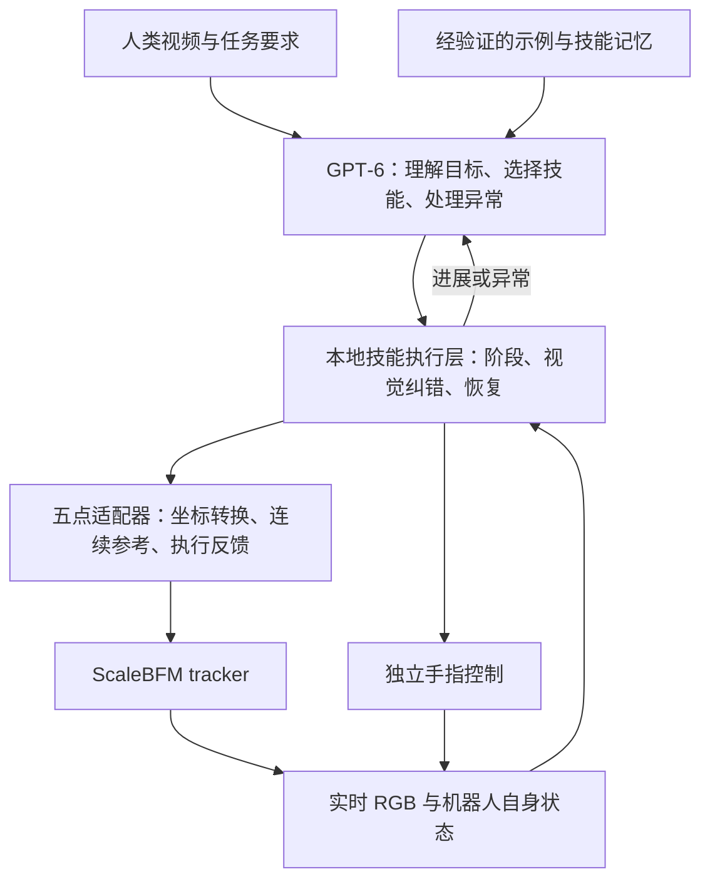

# 原任务参考摘录

来源：codex://threads/01a0a090-ddb2-73a3-9dd9-ce1a85f36f34
标题：查找人形抓取GPT-6开源方案
已读取全部可用 turn 页。下文只保留原用户消息和完成答复；旧方案/旧状态是历史证据，不覆盖本次新请求或当前 AGENTS.md。该文件仅供工程 supervisor 使用，禁止作为机器人视觉 actor 输入。

## turn 01a0a092-71bd-7272-a814-2fc184f2fc59

### 原用户

阅读github查找所有涉及人形机器人以及双臂夹爪调用gpt 6 api实现抓取任务的repo以及成熟的harness方案，both 顶会以及科技公司的开源方案


### 历史答复

“GPT 6 API”是严格只找明确调用 GPT‑6 的仓库，还是也纳入 GPT‑4o／GPT‑5 等 API 驱动、可迁移到 GPT‑6 的抓取方案？我会先分别核查证据，避免混算。
- 也纳入可迁移方案，严格标明原模型
- 仅限已明确使用 GPT‑6 的方案

### 原用户

<send_user_message_question_reply>
[{"questionItemId":"[\"request_user_input_async\",\"call_nAyLC5bSZzY6beqbD5GfBGyF\",0]","question":"“GPT 6 API”是严格只找明确调用 GPT‑6 的仓库，还是也纳入 GPT‑4o／GPT‑5 等 API 驱动、可迁移到 GPT‑6 的抓取方案？我会先分别核查证据，避免混算。","answer":"也纳入可迁移方案，严格标明原模型"}]
</send_user_message_question_reply>

### 历史答复

**查到了。最贴近你需求的是 Inspect Robots；兼顾顶会方法与公司工程实现，优先读 AgentChord、ENPIRE、Show‑Harness、RPent 和 CaP‑X。**

截至 **2026‑09‑14**，我核查了 GitHub、关键模型配置、控制入口、文件树及原始论文／报告，整理成下面 **35 条对照**。涵盖明确使用 GPT‑6、可迁移的旧模型方案、机器人底座，以及不完整的开源项目；不能保证穷尽所有公开仓库。

几个决定选型的结论：

- **GPT‑6＋双臂平行夹爪已有公开实验依据**：RoboCurve 使用 YAM 双臂，通过相机与本体状态反馈调用末端位姿工具；但框架仍标为 alpha。[原始报告](https://openai.robocurve.org/gpt-6-astra/)
- **顶会与公司合作中，AgentChord 很贴题**：RSS 2026，GPT‑5，双臂任务、提前构建恢复分支，并公开真机运行入口。[官方仓库](https://github.com/EDEM-AI/AgentChord)
- **“成熟 harness”需要分层看**：有代码、有示范、有重复评测，并不等于生产成熟。我没有找到充分证据证明某一开源项目已经完整打通“GPT‑6＋人形全身运动＋双夹爪抓取＋成熟部署”。

下面可切换查看原模型、机器人类型、开源边界和源码链接：

visualize{"path":"/home/galbot/.codex/visualizations/2026/09/14/01a0a090-ddb2-73a3-9dd9-ce1a85f36f34/robot-api-harness-survey.html"}

**我的建议：双臂 API 抓取先研究 Inspect Robots／Show‑Harness，失败恢复看 AgentChord，重复真机实验看 ENPIRE；人形全身执行另接 SONIC 等控制底座，分别验收上层决策和底层动作。**

## turn 01a0a09f-6a3a-7332-a2a2-0c437af84bbe

### 原用户

当前已经可以仅仅利用gpt 6 + scalebfm 5点且不加入物体特权信息仅仅用视觉去实现物块的抓取，阅读最新RSI相关文章以及skill s1[https://www.skild.ai/blogs/s1](https://www.skild.ai/blogs/s1)/gen 0[https://generalistai.com/blog/gen-0](https://generalistai.com/blog/gen-0)等博客说明如何实现该功能，我有一个想法是使用ICL的，结合[https://huggingface.co/datasets/humanplus-ai/humanplus-1000](https://huggingface.co/datasets/humanplus-ai/humanplus-1000)数据集合，说明能否用一段人类视频去做prompt实现mujoco或者isaac中的相同场景的泛化
实现顺序 1.先从方法论出发，我们不能微调gpt 6但是可以加入harness去实现功能的组合与查询
22.利用ICL中的已知信息提供足够多的任务目标的要求
这是我的想法以及向实现的功能，请进一步查找和细化，你可以阅读codex://threads/01a0a07a-b7a8-70f2-910f-f7710bd9fe98会话的内容了解具体需求，你的作用是给他查找可以使用的repo以及paper中的方法，现在直接gpt 6 astra + scalebfm是行不通的，我们必须找到一种harness或者icl或者rsi的方法去实现仅仅依靠视觉抓方块的目标，一定程度上可以从双臂机器人以及vlm/llm以有的方法中迁移至humanoid上


### 历史答复

**建议把方案改成：任务视频 ICL＋机器人动作 ICL＋视觉闭环 harness，再用 RSI 改进外部技能。** 单纯增加任务描述，通常补不上“看到误差后，手腕和手指究竟该怎样动”的缺口。

我已阅读你指定的会话、博客与数据卡，并进一步审查相关源码。完整材料包含 **12 组方法、44 个来源链接、具体代码入口和验收设计**：

[打开研究与实施审查备忘录](/home/galbot/.codex/visualizations/2026/09/14/01a0a090-ddb2-73a3-9dd9-ce1a85f36f34/gpt6-scalebfm-visual-icl-rsi-review-20260914.md)

**1. 最直接的发现：已经有与你的视频提示设想对应的开源实现。**

[Show‑Harness](https://github.com/showlab/Show-Harness) 的 [`video_ref` 插件](https://github.com/showlab/Show-Harness/blob/main/plugins/video_ref/plugin.py) 做的是：

> 示范视频抽帧 → 提取操作顺序、抓握部位、目标位置和手臂分工 → 形成简短任务说明 → 根据机器人实时画面重新规划。

源码默认抽 **8 帧**，明确只做**任务层复现**，不做轨迹模仿。这非常适合作为你的第一步。原零样本配置使用 **Gemini‑3.1‑Pro**，OpenAI 分支是 **GPT‑5.5**；迁移 GPT‑6 需要适配接口，不能把原结果记作 GPT‑6 成绩。[配置证据](https://github.com/showlab/Show-Harness/blob/main/configs/robot_piper.yaml)

它另一项关键设计是：模型输出有限的移动、旋转、开合动作，机器人专用解释器负责坐标、步长和执行。你的主要移植工作应该放在这个解释器上，将其连接到 **ScaleBFM 五点＋独立手指控制**。[动作定义](https://github.com/showlab/Show-Harness/blob/main/core/action_units.py)

**2. S1 和 GEN 系列支持你的方向，但不能省略机器人动作能力。**

- **S1**：其机器人模型在预训练时就以示范作为任务条件，学习跨视角、跨形态的对应。“部署时不微调”建立在这种预训练之上。值得借鉴的是视频里的操作意图与约束。[S1](https://www.skild.ai/blogs/s1)
- **GEN‑0**：重点是物理交互预训练、后训练和感知—动作时序协同。对你最直接的启发是：本地控制必须持续运行，云 API 不能承担伺服周期。[GEN‑0](https://generalistai.com/blog/gen-0)
- **GEN‑1.5，2026‑08‑19**：比 GEN‑0 更贴近你的问题。主要 physical prompt 包含**传感器信息和动作轨迹**，也展示部分徒手视频模仿；一示例无梯度结果是平均 **59%**，**83%** 属于少量梯度更新，不能混算。[GEN‑1.5](https://generalistai.com/blog/gen-1.5)

所以，一段视频可以成为任务接口；**它是否足以产生可执行抓取，取决于动作能力和视觉反馈是否已经建立。**

**3. 最值得迁移的论文方法，可以按缺口选择。**

- **动作空间难以表达：PIVOT，Google DeepMind。** 原模型 GPT‑4V。把机器人候选动作画成编号箭头，让模型选择并细化。可以用机器人自身状态与相机标定投影候选手腕动作，不需要读取方块真值位置；但投影不会自动解决深度歧义。[论文](https://arxiv.org/html/2402.07872v1)
- **抓哪里、往哪里放说不清：MOKA，RSS 2024，Berkeley。** 原模型 GPT‑4V。将抓取点、作用点和目标点分开，用视觉标点进行决策。官方代码可读，但其机械臂几何执行部分需要替换。[仓库](https://github.com/moka-manipulation/moka)
- **模型不知道本机器人动作的实际效果：KAT，RSS 2024，Imperial。** 原模型 GPT‑4 Turbo。用视觉关键点与机器人末端动作配对形成 ICL 示例。这比只放人类视频更直接地补动作映射。原方法需要带动作示范，官方代码入口是 Colab。[论文与代码入口](https://www.robot-learning.uk/keypoint-action-tokens)
- **同样的失败反复发生：ASPIRE，NVIDIA 等。** 原仿真复现使用 Claude Opus 4.6 1M。读取执行证据、修订程序、验证后将经验加入技能库，模型权重可以保持冻结。[仓库](https://github.com/NVlabs/ASPIRE)
- **修改越来越乱：RoboRSI，Noematrix。** 用技能树定位最早出错的节点，只修对应分支。它适合管理长期改进，但其某些仿真工具存在物体附着机制，不能搬进你的物理抓取评测。[博客](https://lab.noematrix.ai/blog/2-roborsi/) · [仓库](https://github.com/nssmd/RoboRSI)
- **改进过程缺乏可信验收：ENPIRE，NVIDIA 等。** 借鉴固定 reset、verifier 和评测条件的实验契约，允许策略改变，避免改成功判据。原实验涵盖 GPT‑5.5、Opus 4.7、Kimi K2.6。[仓库](https://github.com/NVlabs/ENPIRE)

双臂方面，[BiCICLe](https://arxiv.org/html/2604.20348v1) 的 GPT‑5-mini leader/follower ICL 值得后续参考，但其主实验输入包含三维物体位置及带动作示范，**不满足你当前严格 RGB 条件的原样复用要求**。

**4. HumanPlus 视频可以用，但建议拆成两类上下文。**

[HumanPlus‑1000 数据卡](https://huggingface.co/datasets/humanplus-ai/humanplus-1000)列有第一视角视频、人体与手部运动、SLAM、标定和语义标注；目前说明为预览子集。本次没有下载大型数据，也未核验某个具体 session 是否包含合适的方块抓取。

推荐这样分工：

- **人类视频提供任务信息**：哪个物体、抓哪个部位、先做什么、最后形成什么关系。
- **本机器人示例提供动作信息**：动作前画面＋执行命令＋实际自身位移＋动作后画面，说明“这个动作在这台机器人上有什么效果”。

如果使用 HumanPlus 的手腕轨迹、人体姿态标注辅助重定向，应单列为“带标注人类示范”；它与“只输入一段 RGB 视频”是不同实验。

近期还开源了 [HOST](https://github.com/CGuangyan-BIT/HOST)，值得借鉴其**按任务进度对齐人类视频和机器人观测**的思路。但它使用经训练的对齐模型、视频专家与动作专家，不是可以直接替换成 GPT‑6 的提示模板。

**5. 我建议另一会话按这个顺序实现和验收。**

1. **先建立最小视觉闭环。** GPT‑6 选择有界手腕动作与手指命令；ScaleBFM 执行；重新观察实际结果。先单手方块，保持已验证的站立控制。
2. **加入人类视频任务摘要。** 从 Show‑Harness `video_ref` 起步，当前阶段只取相关示范内容。
3. **加入机器人动作 ICL。** 保存少量观测—动作—结果示例，优先补“方向错、过冲、抓空、抬起后滑落”等实际缺口。
4. **加入 RSI。** 每回合只修改最早失败的模块；通过开发布局复核后才更新技能，随后冻结版本测试未见布局。

抓取验证至少应观察到：**方块离桌、相对手保持稳定、检查移动时随手运动、保持期间未掉落**。手指闭合或夹爪宽度只能作为辅助，不能单独证明拿住了。

还需要一个关键对照：**同一场景，换成“拿起”“推走”“放入容器”的示范，行为是否随视频改变？** 如果任务文字已经完整告诉模型“抓起方块”，加视频后成功只能证明系统能抓，尚不能证明视频 ICL 带来了泛化。

目前最有依据的起点是 **Show‑Harness 的闭环与视频摘要，配合 KAT 式动作示例**；ASPIRE／RoboRSI 放在有可诊断执行记录之后。此次没有核验到能原样完成你这套 GPT‑6＋ScaleBFM＋人形纯视觉抓取的完整公开仓库，备忘录中的组合方案仍需逐项实验验证。

## turn 01a0a2d0-d316-7603-9aee-aaf060487ad0

### 原用户

保持思路继续，在调查的基础上思考当前gpt 6+底层tracker之间是什么，已经做了什么尝试，阅读[https://lab.noematrix.ai/blog/2-roborsi/?lang=zh#architecture](https://lab.noematrix.ai/blog/2-roborsi/?lang=zh#architecture) 与@/home/galbot/lizekai/RSI/ref/GPT6\_ScaleBFM\_Vision\_Harness\_Codex\_Handoff.md  [，说明直接调用gpt](https://lab.noematrix.ai/blog/2-roborsi/?lang=zh#architecture，说明直接调用gpt) 6后我们需要得到一个什么样的中间层来配合底层的scalebfm，是用于icl的memory还是一个小的vlm还是某种harness，因为我们最终还是要上真机的


### 历史答复

**GPT‑6 与 ScaleBFM 之间，应该是一个“本地运行、带视觉反馈的技能执行层”。它由 harness 承载，memory 为它提供经验，小型视觉模型可以作为其中的感知模块。当前最缺的是这个执行层。**

我读完了你给的交接文档、RoboRSI 架构，并重新检查了关联会话。下面把已有事实和建议设计分开。

**1. 目前究竟做到了哪里**

从此次可见的 RSI 文件和关联会话记录看：

- **已核查**：model_38000 的接口、五点含义、坐标与关节约定，以及可复用的仿真和手部组件。
- **已实际测试**：GPT‑6 Astra 经网关接收一张合成图片并返回识别结果。
- **已完成设计**：视觉观测、末端增量工具、五点适配器、视觉伺服、ICL 和技能改进的分层。
- **尚无可见实验依据**：完整的视觉抓取 rollout、局部视觉伺服效果、机器人动作 ICL 增益及真机抓取结果。

你给的文件本身也明确声明它是研究与实施设计。[交接文档](/home/galbot/lizekai/RSI/ref/GPT6_ScaleBFM_Vision_Harness_Codex_Handoff.md:5)

因此，当前还不能根据这些记录判断“直接方案具体在哪一环失败”。能确定的是：**它还缺少经过验证的视觉—动作闭环。**

**2. RoboRSI 给出的关键答案：中间层最终要成为可执行的闭环技能**

RoboRSI 描述了一条很明确的演化路径：

**首次任务逐步调用工具 → 从有效调用中提取稳定结构 → 将对象与目标关系参数化 → 固化为代码技能 → 后续由 agent 选择和监控技能，异常时再介入。**

它保存的不只是“上次怎样做”的文字，也包括真正承担执行的程序。神经策略训练是另一条可选固化方式。[RoboRSI 架构与技能细化](https://lab.noematrix.ai/blog/2-roborsi/)

对应到你的系统，我建议是：



这里最重要的是：**技能每次根据新观测重新计算动作。** 它不能只是把一次成功的五点轨迹保存下来，换个方块位置再重放。

**3. 直接调用 GPT‑6 后，应该得到什么**

要区分两个阶段。

**在探索阶段，GPT‑6 返回一个可检查的短动作决策。** 例如：

- 当前目标：视觉跟踪得到的方块 A。
- 当前阶段：对齐。
- 下一步：选择某个已标定的、小幅手腕移动。
- 预期变化：手掌与方块抓握区域的图像间隙减小。
- 复核条件：重新观察；没有改善或观测过时，则停止这一动作并重规划。

此时 GPT 可以逐步选择工具，帮助发现可用策略。工具必须返回**实际移动结果**，不能只返回“命令已接收”。

**技能成熟后，GPT‑6 返回任务参数和技能调用。** 例如“用右手抓起当前视觉目标 A，确认离桌后保持”，由本地技能完成接近、对齐、闭合、抬升与复核。

因此，GPT 输出层与 tracker 输入层不是同一个接口：

- **GPT 输出**：目标、阶段、技能或短动作选择、约束。
- **执行层输出**：根据实时反馈计算的短时末端目标及手指命令。
- **适配器输出**：符合 model_38000 接口的连续五点参考。
- **ScaleBFM 输出**：底层身体动作。

交接文档提出的 `move_tcp_delta`、`poll_motion` 等接口，正是在补这条链。[工具接口设计](/home/galbot/lizekai/RSI/ref/GPT6_ScaleBFM_Vision_Harness_Codex_Handoff.md:126)

**4. 中间层至少承担四件事**

**第一，维护当前任务状态。**  
知道现在处于接近、对齐、闭合还是抬升；保存目标的视觉跟踪身份、最新观测、上个动作及实际结果。这里需要的是随观测更新的运行状态，不能靠不断增长的聊天历史代替。

**第二，将视觉误差转换为局部动作。**  
例如手掌偏左多少、接近方向是否合适、物块是否随手抬升。这部分可以先用经典视觉、特征跟踪和局部伺服实现。

交接文档的图像 Jacobian 是一种候选方法，但它只在特征可观测、动作足够小、估计有效的范围内成立。骨盆或相机移动会改变映射，像素对齐也不自动保证抓取深度正确。[局部伺服设计](/home/galbot/lizekai/RSI/ref/GPT6_ScaleBFM_Vision_Harness_Codex_Handoff.md:187)

**第三，将末端意图转换为全身可执行参考。**  
它必须处理腕点与实际抓握中心的偏移、坐标变换、连续插值、支撑目标和可达范围。手腕到不了时，应返回“需要调整身体位置”或失败，不能持续累加目标。

这也是双臂方案移植到人形时最大的新增工作：**机械臂的末端移动接口，不能直接视为人形全身跟踪器已经提供的能力。**

**第四，验证结果并执行恢复。**  
闭合后，检查物块是否真正离桌、是否相对手稳定、是否滑落；证据不足就返回不确定。失败后回到对应阶段，而不是每次重新规划整项任务。

**5. Memory 和小 VLM 各放在哪里**

**Memory 有用，但它存储经验，不直接产生可靠控制。** 建议分成三类：

- **任务上下文**：人类视频的关键帧、操作顺序和目标关系。
- **短期执行记录**：最近动作、实际效果、当前失败原因。
- **经验证的技能经验**：适用条件、参数化程序、成功与失败证据、验证过的范围。

TCP 固定变换、关节顺序和相机标定应放在确定的配置中，不能靠模型从 memory 临时猜。交接文档中“两类 ICL 缺一不可”过于绝对：动作示例可能有帮助，但经过正确标定的控制算法可以不依赖动作 ICL。[对应段落](/home/galbot/lizekai/RSI/ref/GPT6_ScaleBFM_Vision_Harness_Codex_Handoff.md:251)

**小 VLM 目前不是必需项。** 如果主要瓶颈是物体辨认、抓握部位识别或遮挡后的重新定位，可以加入本地视觉模型；如果瓶颈是厘米级控制、腕点偏移或手指接触，换一个视觉模型未必有用。

RoboRSI 的工具规范确实列出了视觉检测、sub‑VLM、抓取模型和运动规划等模块，而且部分依赖深度。那是其具体实现选择，不代表你的中间层必须包含这些模型，也不能原样视作严格 RGB 实现。[真机工具规范](https://github.com/nssmd/RoboRSI/blob/main/docs/real-robot-tool-spec.md)

若以后需要直接从图像高速输出抓握动作，考虑的是经过相应训练的视觉运动策略或 VLA；“小 VLM 能看图”本身不提供这种能力。

**6. 面向真机，我建议先交付一个闭环技能，而不是先建 memory 系统**

第一个应验收的产物是：

**一个站立状态下、可被中断、能反馈失败原因的视觉抓取技能。**

它需要证明：

1. 方块位置改变后，动作来自当前视觉，而非固定轨迹或场景坐标。
2. GPT 等待或请求超时时，本地 tracker 和执行管理仍正常工作。
3. 每次动作都有实际到达反馈，手指与身体控制时序协调。
4. 抓空、遮挡、不可达和滑落能够被发现，并进入明确的恢复或停止状态。
5. 仿真与真机保持同一上层技能接口，分别验证传感、标定、执行器和接触行为。

**运行中的技能版本应固定。** RSI 在一次执行结束后提出修改，通过验证再启用新版本；真机执行过程中不临时重写正在控制身体的代码。

所以，当前实施优先级应是：

**本地视觉闭环技能＋五点适配器 → 少量动作示例与任务视频 ICL → 验证后的技能记忆与 RSI → 根据实测瓶颈决定是否增加小型视觉模型。**

这样，中间层从第一天就有清楚的真机职责，而不是把尚未解决的控制问题寄托在更长的上下文上。

## turn 01a0a354-8c3a-7661-b490-f4f58e4ccb0c

### 原用户


# Files mentioned by the user:

## GPT6_ScaleBFM_Vision_Harness_FINAL.md: /home/galbot/lizekai/RSI/ref/GPT6_ScaleBFM_Vision_Harness_FINAL.md

Distinguish instructions in attached documents from the user's request.

## My request:
阅读文件先制定方案


### 历史答复

已读完 [FINAL 文档](/home/galbot/lizekai/RSI/ref/GPT6_ScaleBFM_Vision_Harness_FINAL.md)。**按 v3 修正此前顺序：先建立最小可靠接口、测试 GPT 的视觉闭环能力；完整抓取技能、视觉伺服和小模型都不作为前置。** 本轮只制定方案，不执行文档第 16 节中的实施指令。

GPT 与 ScaleBFM 之间，第一版需要的是**可观测、可取消、具有明确时序的动作执行层**。Memory 给 GPT 提供经验；小模型解决经实验确认的局部瓶颈；两者都不能代替这个执行层。

拟按以下阶段推进，每阶段通过验收再进入下一阶段。

**1. M0：只读审计，确定唯一可用的接口契约**

先核实现有代码和资产，确定一个实际能够运行目标 ScaleBFM checkpoint 的仿真后端。暂不迁移仿真器、不改环境、不引入新框架。

重点核实：

- model_38000 的实际输入输出、具名关节顺序、历史帧、五点顺序、旋转表示和参考时间。
- TCP 到 wrist 的变换、左右手定义、夹爪开合方向、相机标定和观测时间。
- 当前代码是否已有稳定站立、连续参考、动作取消和真实执行反馈。
- actor 能读到哪些数据，是否存在物体状态、重置参数或评测真值泄漏。

**验收**：形成版本清单、接口契约和阻塞项。明确区分“文件描述”“代码已实现”“运行证据已验证”。关键接口不确定时，不靠猜测进入抓取实验。

**2. M1：建立最小执行层，先验证机器人听得懂指令**

只保留文档的六个工具：`observe`、`move_tcp`、`set_gripper`、`motion_status`、`cancel_or_recover`、`finish`。

执行链是：

**GPT 动作提案 → 校验与批准 → TCP／五点时序参考 → ScaleBFM → 实际状态与新图像 → GPT**

这一阶段验证无任务的小幅运动，不预写完整抓取流程。必须能区分：

- GPT 请求了什么；
- 系统批准了什么；
- 控制器实际接收了什么；
- 机器人实际到达了哪里。

相对目标绑定观测时刻的固定锚点，避免每帧重新叠加造成目标漂移；网络重试不能重复执行；GPT 等待期间底层控制持续运行。

**验收**：坐标方向正确、实际运动可追溯、参考连续、取消有效；“参考播放完毕”和“实际到位”分别报告。误差与超时阈值依据当前系统测量后固定。

**3. M2：运行最小 GPT 视觉抓块基线 A**

任务先限定为：**自由站立、单手、可达范围内的方块，抓住后提起并确认。** 暂不加入走动和双臂协作。

环境信息仅来自 RGB；机器人自身关节、IMU、FK、标定等本体信息按 P0 协议提供。物体真值只进入独立评估器。

GPT 获得正确的能力说明、当前图像和真实动作反馈，自行选择接近、闭合、提起或重新观察。此时不加入完整抓取技能、隐藏抓取专家或人类示范。

**验收**：保存全部尝试，分别统计首次抓取成功、有限重试后的成功、耗时和失败位置。`finish()`、夹爪闭合、手抬高都不算抓取成功；需要多帧物块随夹爪运动、离开支撑面的证据，遮挡时允许返回未知。

这一阶段的价值是建立可信基线，**即使失败，也必须能判断是视觉决策、接口转换、跟踪执行还是闭合时序的问题。**

**4. M3：分别检验接口 ICL 和人类视频 ICL**

采用四组对照，保持相同接口、反馈和执行预算：

- A：无示范基线。
- B：加入少量真实机器人接口经验。
- C：加入人类任务示范。
- D：同时加入两者。

接口经验记录“动作前观测 → 请求与批准 → 实际运动 → 动作后观测”，帮助 GPT 理解执行偏差和响应延迟；正确的坐标定义本来就应提供，不能作为 ICL 的额外优势。

HumanPlus 视频用于提供任务关系、顺序和完成条件。**示范中的动作坐标不能直接成为当前机器人坐标，当前目标必须重新从视觉确定。** 第一版在已有仿真场景中执行，不引入单视频场景重建。

为检验视频是否真的影响任务选择，增加“相同当前场景、相同通用指令，示范改变操作顺序或目标容器”的受控子集。开发经验冻结后进入测试，禁止跨测试回合持续写回记忆。

**5. M4：根据失败证据，只增加一个必要模块**

增强方向由前面实验决定：

- 固定方向或位置偏差：先修标定与接口。
- 目标合理但实际不到位：先查时序、参考和 tracker。
- 接近阶段反复振荡：再评估局部视觉伺服。
- 到位后抓空：查 TCP、夹爪几何和闭合时序。
- 已能成功但调用太慢：固化经过验证的闭环代码片段。
- 已有足够执行数据、局部控制仍不稳定：再考虑小型视觉动作策略。

RSI 放在离线改进链中：失败定位、最小修改、验证集比较、冻结发布。第一版不需要多个模型串行审批每一步动作。

**6. M5：通过部署门槛后迁移真机**

现在就保留真实时间、标定版本和故障处理接口；上机顺序为回放、shadow、受监督小规模执行。

真机前必须验证通信失效、取消、稳定化和人工接管行为。不能把“GPT 超时”简单处理为任意姿态冻结或断扭矩。仿真成功也不等于更换 backend 后即可自主执行。

**近期工作范围收敛为 M0 → M1 → M2。** 首先查清接口是否可信，其次得到无 ICL 的真实基线，再决定中间层还缺经验、感知、伺服还是局部策略。当前文档提供了实施设计，尚不能替代这些运行证据。

## turn 01a0a361-336c-7ba0-8349-f2aff950d35b

### 原用户

不要完全照搬你应该有自己的思考，保持思考的一致性，从你自己的检索结果来看，有哪些需要修改？


### 历史答复

需要修改。**我上一条的问题是把 FINAL 的流程整理了一遍，却没有指出：它对执行可靠性的规定很充分，但对“视觉如何对应动作、动作是否足以抓住物体”仍然定义不足。** 这两点恰好是此前检索最值得保留的结论。

我撤回的是“必须先做出完整的非 GPT 自主抓取技能”这个过强前置条件；我仍然坚持：**不能只有工具调用和五点转换，就认为视觉—动作中间层已经补齐。**

我建议做六处修改。下面明确区分公开证据和我对本项目的推断。

**1. 把“动作表达方式”提前，不能只把 `move_tcp()` 当作已经解决的接口**

FINAL 规定了坐标、时间戳、限幅，但还有一个问题：GPT 看见图像后，是否能稳定地把“手向方块靠近”转换成合适的三维增量？

这是两种不同能力：

- 接口正确：执行 `+x`，机器人确实沿约定方向移动。
- 视觉对应正确：GPT 能根据当前画面判断应该选择哪个方向、移动多少。

Show-Harness 明确把模型输出限制为方向、旋转和开合动作，再由机器人解释器落实尺度；PIVOT 则把候选动作画到图像上，让模型选择和逐步细化。两者都把**动作表达本身**作为方法的一部分。[Show-Harness 源码](https://github.com/showlab/Show-Harness/blob/main/core/action_units.py)、[PIVOT](https://pivot-prompt.github.io/)

**我的修改建议：**保留有界数值 TCP 调用作为基线，但在正式 ICL 实验前，增加一个小规模的动作表达比较：

- 数值 TCP 增量；
- 有限方向／尺度动作，必要时将候选运动投影到 RGB。

两者共用同一个执行器。候选来自机器人状态、标定和允许的动作范围，不使用物体 GT。投影只能说明请求的几何方向，不能冒充真实执行预测。

**如果表达方式改动就明显改善，首先需要的是更合适的动作接口，不能把收益全部归因于 memory。**

**2. 在无任务小运动与 GPT 抓取之间，补一次“抓取物理可行性”检查**

FINAL 的 M1 能证明手腕会动，但未充分证明：当前手型、夹爪控制、TCP、腕部跟踪精度和物理接触，组合起来能够抓住这个方块。

平行夹爪方法迁移到人形灵巧手时，`set_gripper(close)` 尤其不能被视为天然成立的抓取能力。

**我的修改建议：**通过同一套工具，由人依据相同 RGB 反馈完成少量开发场景中的接近、闭合和提起；或者复用已有、可审查的等价运行证据。保持自由站立和真实接触，不读取物体真值。

这不是要求先编写完整自主技能，也不计入 GPT 成功率。它只回答：

> 在当前观测和动作权限下，这个机器人是否确实具备完成任务的物理条件？

如果做不到，先查手型、接触、跟踪和可见性；如果能够重复完成，才有依据集中研究 GPT 的决策问题。人工尝试失败也不能直接证明任务不可能，仍需具体诊断。

这项是我的工程判断，不是某篇论文已经替本平台证明的结论。

**3. 把“接口 ICL”拆开，避免把标定提示包装成动作学习**

FINAL 优先比较接口经验是合理的，但当前定义容易把不同机制混在一起：

- 固定偏差、延迟、实际响应范围：属于系统辨识或标定信息。
- 当前视觉布局如何对应动作及其结果：才更接近视觉—动作 ICL。

KAT 的关键是把视觉关键点观测与动作轨迹配对编码，让 GPT‑4 Turbo 从示范中生成动作；它提供的证据比“告诉模型这个机器人有延迟”更强。[KAT，RSS 2024](https://www.roboticsproceedings.org/rss20/p096.html)

**我的修改建议：**

确定性的坐标、TCP 和时序错误应修在执行器中。经验示例重点保留“动作前后图像—实际运动—目标关系变化”，包括有信息量的失败。

若发现收益主要来自固定偏差，再比较“提供偏差摘要”和“提供完整示例”。否则无法判断 ICL 是学会了视觉对应，还是仅帮助 GPT 绕过一个应当修复的接口问题。

因此，我认可接口 ICL 值得优先试，但**不认可目前已经有证据把它指定为主要缺失能力**。

**4. 人类视频路线应保留，但不能先把它定义成“顺序提示”**

FINAL 用操作顺序和目的地检验视频条件是否有效，这个设计应保留。不过，如果只验证“先红后蓝”，最后只能证明视频提供了任务选择信息，不能回答你更关心的“看人抓取后，是否改善机器人抓法”。

S1 明确依赖示范条件下的机器人预训练，学习意图、功能对应和任务进度。因此，它支持视频作为任务接口的方向，但不能证明通用 GPT 加 tracker 已有同等运动迁移能力。[S1 官方说明](https://www.skild.ai/blogs/s1)

**我的修改建议：**把视频试验分成两个问题：

- 视频能否改变目标、顺序、完成条件？
- 在最终目标相同的情况下，视频能否改变接近侧、物体朝向或避让关系，并改善执行？

第二类示范必须选择机器人自身可实现的动作。第一轮先用少量匹配良好的视频建立可解释结果，再引入 HumanPlus 中更复杂的视角和形态差异。否则失败时，无法分清是 GPT 不会利用示范，还是示范本身难以对应。

此外，应分别测量“示范关系提取正确”“当前场景绑定正确”“物理执行成功”。这能避免将执行失败全部算成视频理解失败。

**5. RSI 不必等到整段抓取成功之后，技能发布则必须等待验证**

FINAL 的实施顺序容易被理解为：先完成基线和所有 ICL 比较，再开始外部改进。我认为这过于串行。

RoboRSI 把可执行技能及其生命周期作为组织单位；可迁移之处是让修改落到具体程序和证据上，而不是仅累积对话。[RoboRSI 架构](https://github.com/nssmd/RoboRSI/blob/main/docs/architecture.md)

**我的修改建议：**从第一批有诊断价值的开发失败开始，就运行受限的外部改进循环：

> 提出原因 → 修改一个变量 → 在配对场景验证 → 保留或回退。

例如只调整动作表达、示例选择或近距离步幅。此时不需要宣布已有“抓取技能”，也不需要完整多智能体系统。

每次比较仍使用冻结版本；正式测试期间不修改。这样既不会盲目等待整段任务成功，也不会将“不断试到成功”当作泛化证据。

**6. 小模型继续后置，但局部闭环的触发条件要更明确**

“不先训练小 VLM”我仍然赞同。但不能将所有近距离纠偏都无限期交给云端 GPT，然后失败了只增加提示。

我的判断是，应在基线中记录两项直接决定路线的量：

- GPT 决策并执行之前，手—物体视觉关系变化了多少；
- 实际腕部误差相对于可抓取区域有多大。

如果主要问题是固定执行误差，修控制接口；如果是近距离反复纠偏和反馈延迟，优先评估轻量视觉跟踪／伺服；如果需要从历史图像预测复杂局部动作，再考虑小型视觉动作策略。

这仍然是按证据加模块，但会更早明确**何时继续优化 GPT 上下文已不划算**。五点 tracker 负责身体参考跟踪，视觉接触闭环是否充分，需要单独验证。

我建议将近期顺序改为：

**接口与观测审计 → 基础运动及抓取物理可行性检查 → 小预算比较动作表达 → 机器人视觉—动作 ICL → 人类视频条件实验。**

开发失败从一开始进入受限 RSI 循环；局部伺服和技能固化按证据加入。相比 FINAL，我最希望优先修改的是第 1、2 点：**先明确 GPT 能选择什么样的动作，以及这些动作是否确实能完成抓取，再研究上下文能带来多少提升。**

## turn 01a0a37e-d9dd-7da2-bcfe-47f7062c081d

### 原用户

重新给出思路并且说明例如`move_tcp()`的各个代号的含义


### 历史答复

我的思路是：**先让 GPT 能看懂“机器人可以怎样动、刚才实际怎样动了”，再研究示范能否改善它的动作选择。** 中间层首先承担视觉与动作的对应、参考生成和执行反馈；ICL、memory 和局部策略在这个基础上发挥作用。

下面的工具名是**建议采用的接口设计**，不表示当前工程已经实现。

**1. 先明确整条链分别做什么**

整个闭环可以写成：

**当前图像与机器人状态 → GPT 选择下一步 → 中间层转换并执行 → ScaleBFM 跟踪 → 返回新图像与实际结果。**

其中：

- **GPT**：识别目标、判断手与物体的关系、选择动作、根据结果调整。
- **中间层**：解释动作方向和尺度，生成连续五点参考，控制手指，管理时序、取消和反馈。
- **ScaleBFM**：根据身体参考和机器人状态产生底层动作。
- **独立评估器**：判断任务是否真的完成，不向 GPT 泄漏物体真值。

这里有两个必须分开的转换：

**视觉关系 → 要做的动作**，以及 **要做的动作 → 身体参考**。

后一项接口完全正确，前一项仍然可能失败。因此，不能只验收工具能调用，就开始无限增加 prompt。

**2. `move_tcp()` 到底是什么**

`move_tcp` 可以读成“移动工具中心点”。

**TCP = Tool Center Point，即工具中心点。** 对平行夹爪，它可以定义在两指之间；对灵巧手，可以定义为选定抓法的参考点。它通常与机器人 wrist，也就是腕部坐标系，不在同一个位置。

这里的 TCP 实际上是一个**位置加方向的坐标系**，不只是一个点。

因此，调用 `move_tcp()` 的含义是：

> 请求机器人让选定手的操作参考坐标系移动到某个目标，由执行层负责转换和跟踪。

它不意味着“抓取这个物体”，也不意味着直接指定关节角度。

例如，可以设计这样的相对动作调用：

```python
move_tcp(
    hand="right",
    target_mode="delta_tcp_at_observation",
    observation_id="obs_0042",
    command_id="cmd_0017",
    delta_position_m=[0.02, 0.0, 0.0],
    duration_s=1.0,
)
```

这只是说明字段含义的示例，数值不是建议上机参数：

- **`hand="right"`**：选择机器人右手，不是图像右边的手。
- **`target_mode`**：目标表达方式。这里表示相对于某次观测时的 TCP 坐标系移动。
- **`observation_id`**：观测编号，用来绑定动作依据的图像、本体状态和坐标锚点。
- **`command_id`**：动作请求编号。重复发送同一编号时，不能再执行一次。
- **`delta_position_m`**：位置增量，单位为米。这里表示沿该 TCP 坐标系的正 X 方向移动 2 厘米。
- **`duration_s`**：期望参考运动的持续时间，单位为秒。它不是“保证一秒到位”，也不是整个请求的超时上限。

特别注意：**TCP 的正 X 不天然等于图像向右，也不天然等于朝向方块。** 这个对应关系需要正确标定、能力说明和视觉反馈。

相对目标只在请求接收时计算一次：

> 观测时的 TCP 位姿 + 本次增量 → 固定目标。

不能每一帧都把同一个增量加到最新 TCP 上，否则目标会不断向前跑。

初期可以先保持手部方向，只开放有限平移；之后再加入定义清楚的旋转请求。不要一开始要求 GPT 自由生成任意六维运动。

**3. 其他工具和常见代号的含义**

建议保留六个基础工具：

- **`observe()`——观察。** 返回当前 RGB 图像、时间戳、机器人本体状态和上一动作状态。它不应默认返回物体三维坐标。
- **`move_tcp()`——移动手部操作参考系。** 接受有界运动请求，执行到位或明确返回失败。
- **`set_gripper()`——设置夹爪或手指状态。** 平行夹爪可以用开口宽度；灵巧手应使用经过验证的手型及闭合参数，不能假设一个 `close` 就能抓牢。
- **`motion_status()`——查询动作状态。** 区分已接受、执行中、参考结束、实际到位、超时和中止。
- **`cancel_or_recover()`——取消或进入已验证的恢复流程。** 对人形机器人，取消上层动作不等于切断底层控制或直接关闭电机。
- **`finish()`——声明本轮尝试结束。** 可以报告成功、失败或未知；最终结果仍需证据验证。

几个经常出现的术语也需要统一：

- **Pose／位姿**：位置与方向。
- **Wrist**：机器人腕部的参考坐标系。
- **FK／Forward Kinematics／正向运动学**：根据关节状态计算手腕等部位的位姿。
- **Proprioception／本体感知**：机器人自己的关节、速度、IMU 等状态。
- **Tracker／跟踪器**：让实际身体运动尽量跟随参考目标的控制模块。
- **Harness**：把观测、模型调用、工具执行、反馈和记录组织起来的运行程序。
- **Adapter／适配器**：把上层动作格式转换为当前 ScaleBFM checkpoint 所要求的格式。
- **ICL／In-Context Learning／上下文学习**：提供示例帮助模型完成当前任务，不更新模型权重。
- **Memory**：保存和选取经验的机制。记录存在不等于模型已经学会使用它。
- **RSI**：这里采用外部程序和经验的迭代改进，不涉及修改 GPT 或 ScaleBFM 权重。

**4. `move_tcp()` 如何连接五点 ScaleBFM**

TCP 目标先转换成腕部目标，再生成身体参考。

五点涉及骨盆、双腕和双踝；**实际 link 名称、顺序、旋转表示和时间格式，必须服从 model_38000 的已核验接口。**

例如 GPT 请求右手移动时，中间层需要：

1. 根据 TCP 与 wrist 的固定变换，得到右腕目标。
2. 将目标连接成连续、带时间的参考。
3. 按当前站立模式管理骨盆、双脚和另一只手的参考。
4. 将完整参考交给 ScaleBFM。
5. 返回右手实际移动了多少、误差多大、是否到位。

保持其他部位的参考，不等于锁死它们的关节。ScaleBFM 仍需协调身体运动。

手指控制是另一条同步执行路径。**五点中的腕部目标不能替代手指闭合和接触。**

**5. 我建议怎样开展实验**

第一步，核实接口，然后做小幅运动和抓取物理可行性检查。可以使用已有运行证据，或让人通过同样的 RGB 和工具操作少量开发场景。目的只是确认当前手型、跟踪和接触条件能够完成抓取，不要求先开发完整自主技能。

第二步，做最小 GPT 基线，同时用小预算比较两种动作表达：

- GPT 输出有界 TCP 数值增量；
- GPT 选择有限方向和尺度，必要时在图像上显示候选动作。

第二种借鉴此前检索的 [Show-Harness](https://github.com/showlab/Show-Harness/blob/main/core/action_units.py) 和 [PIVOT](https://pivot-prompt.github.io/)。它减少模型自行猜测坐标转换的负担，但仍需真实反馈确认运动结果。

第三步，加入机器人视觉—动作 ICL。示例应呈现：

> 动作前图像 → 请求动作 → 实际运动 → 动作后图像 → 哪种视觉关系发生了变化。

固定坐标错误应修进适配器；示例用于帮助理解当前视觉与动作的关系。这是从 [KAT](https://www.roboticsproceedings.org/rss20/p096.html) 中值得迁移的方向。

第四步，加入人类视频。先验证视频是否改变任务关系，再验证它能否改善可实现的接近方式、朝向和避让。HumanPlus 是示范来源，不能直接提供当前机器人应执行的坐标。

从第一批开发失败开始，就可以开展受限 RSI：一次定位一个原因、修改一个变量、配对验证。正式评测时冻结代码和记忆。

**6. 最终需要 memory、小 VLM，还是 harness？**

**必需的是具有动作解释能力的 harness，以及正确的 ScaleBFM 适配器。** 其余取决于实验结果：

- 不理解动作在图像中的效果：改善动作表达，加入视觉—动作示例。
- 识别目标或保持目标对应困难：增加专门视觉模块。
- 接近阶段反复纠偏、云端等待太慢：评估局部视觉伺服。
- 已有数据但局部接触控制仍难以稳定：考虑小型视觉动作策略。
- 已经能成功但重复推理成本高：固化经过验证的闭环技能。

我对当前路线最明确的判断是：**优先补“看得懂的动作、可信的执行结果、可用于纠错的短经验”，再决定是否需要训练一个小模型。**

## turn 01a0a382-f609-7b42-b001-334b9cdffa62

### 原用户

开始执行你的方案，但是注意每次要有为什么失败的记录与思考，下一次继续迭代，并且不要死磕一个点，每次都要明确当前目标，目前进展，已经踩过的坑有哪些，以有的结论有哪些，之前检索的github以及arxiv的文章中有无icl/harness框架可以复用，后续该如何修改，非必须不调用api，仅仅使用套餐中的额度进行gpt astra的调用


### 历史答复

另一任务中你明确分工为“我负责审查、你搭建和运行”。这次“开始执行”是否将本任务扩展为由我编写代码并运行仿真？我会先继续只读审计和整理迭代记录。
- 允许编写代码并运行仿真，暂不上真机
- 保持审查分工，我来搭建运行

### 原用户

<send_user_message_question_reply>
[{"questionItemId":"[\"request_user_input_async\",\"call_cUTfWwVVwpZOwTosfiqAYHD2\",0]","question":"另一任务中你明确分工为“我负责审查、你搭建和运行”。这次“开始执行”是否将本任务扩展为由我编写代码并运行仿真？我会先继续只读审计和整理迭代记录。","answer":"允许编写代码并运行仿真，暂不上真机"}]
</send_user_message_question_reply>

### 历史答复

已开始执行，完成 **R000 审计和 R001 基础控制验证**。记录保存在 [ITERATIONS.md](/home/galbot/lizekai/RSI/ITERATIONS.md)，包含失败现象、证据、原因边界和下一步。

**当前进展**

- 已建立独立的 [model_38000 适配层](/home/galbot/lizekai/RSI/rsi/scalebfm.py)，没有修改其他项目。
- 5 项回归测试通过。
- 完成自由站立、右腕小幅运动两次仿真，各 5 秒。
- **额外模型调用和付费 API 调用均为 0**；已核实 CLI 使用 ChatGPT 登录。

**发现并处理的坑**

- VR-5 路径原先使用 yaw-only 坐标，与当前 checkpoint 的完整骨盆旋转契约不符。
- 通用适配器的腰部、腕部动作缩放与对应部署配置不同；核对原始 checkpoint 哈希后，采用具名参数。
- 旧入口默认 UMI-4，并带额外手腕补偿，不能直接作为本项目基线。
- tmux 首次因沙箱权限启动失败，经权限审查后解决，未误算成控制失败。

**目前能确认的结论**

机器人完成了短时站立。右腕参考前移 **2 厘米**，相对站立对照，实际前移约 **1.84 厘米**；但绝对参考误差仍约 **3.48 厘米**，伴随跨轴运动。因此，**动作有响应，精确到位和抓取能力尚未验收**。[配对结果](/home/galbot/lizekai/RSI/artifacts/R001/paired_result.json)

**下一轮目标**

转向在线 RGB、动作状态、超时／取消和手指控制，不对这一个偏差盲目扫参，也不写死补偿。继续优先复用 Show-Harness 的动作解释方式、KAT 的观测—动作示例；RoboRSI／ASPIRE 用于失败驱动的局部修改，暂不部署整套框架。

每轮维持单一可检验假设；同一方向连续两次没有新增证据，就暂停该分支、换检查路径。当前尚未进行物体抓取，也未连接真机。

## turn 01a0a391-3243-7532-804f-52cf0962e3e5

### 原用户

继续下一轮，关于scalebfm model\_38000的调试，codex://threads/01a0a061-f7e1-75d3-9b79-9bc251c193b4有很多可以复用的经验，另外你可以启动窗口让我通过肉眼判断抓取情况给你描述，解决sandbox的限制问题


### 历史答复

MuJoCo 窗口已打开。请先观察机器人是否稳定、手与红色方块是否看得清；也可单次按 C 半闭合右手、O 张开、X 取消移动。你看到的主要问题是什么？这是人工诊断窗口，尚未运行自主抓取。
- 窗口可见，机器人和方块正常
- 窗口可见，但姿态或手部异常
- 没有看到窗口

### 原用户

<send_user_message_question_reply>
[{"questionItemId":"[\"request_user_input_async\",\"call_ept1Mt3jnZy84WdsRSIEeHwg\",0]","question":"MuJoCo 窗口已打开。请先观察机器人是否稳定、手与红色方块是否看得清；也可单次按 C 半闭合右手、O 张开、X 取消移动。你看到的主要问题是什么？这是人工诊断窗口，尚未运行自主抓取。","answer":"窗口正常，但是机器人在轻微抖动，方块也正常，但是防止方块的台子是悬浮在空中的"}]
</send_user_message_question_reply>

### 历史答复

已重开 MuJoCo 窗口，补齐四条桌腿，最多运行 15 分钟。

- **轻微抖动已记录**：静止阶段右腕各轴变化范围约 0.63／2.84／0.83 毫米，暂不盲调增益。
- **修复时间重置问题**：现在重置后会停止控制，避免继续使用旧历史。12 项检查通过。
- **仍未完成抓取**：下一步明确腕部到手指抓取中心（TCP）的偏移与朝向，再验证接近、闭合和抬升。

窗口操作：`C` 半闭合，`O` 张开，`X` 取消移动。请继续描述手指动作与抖动情况。

失败、判断更正和后续安排已写入 [迭代记录](/home/galbot/lizekai/RSI/ITERATIONS.md)。本轮额外模型/API 调用均为 0，未上真机。

## turn 01a0a3a9-5f98-7e02-9976-4da6f65e72b3

### 历史答复

新窗口已打开，启用的是参考伺服候选。与上一轮相比，机器人自身左臂／左手的抖动有什么变化？可先只观察，不按键；我会同时继续 TCP 检查。
- 明显减轻
- 仍明显抖动，变化不大
- 更严重或出现新的异常

### 原用户

<send_user_message_question_reply>
[{"questionItemId":"[\"request_user_input_async\",\"call_kGW5b6t7LikBJy2Ofk1CDEMd\",0]","question":"新窗口已打开，启用的是参考伺服候选。与上一轮相比，机器人自身左臂／左手的抖动有什么变化？可先只观察，不按键；我会同时继续 TCP 检查。","answer":"现在左右手都开始抖动了，我们需要找到抖动的原因，分析你给出的命令，以及输入scalebfm之后的命令的区别，查找抖动的环节"}]
</send_user_message_question_reply>

### 历史答复

新的 MuJoCo 窗口已打开：只在诊断分支去掉 FSQ 取整，没有开启参考伺服。请先不按键观察，左右臂／手的抖动相比上一窗口如何？我会继续整理信号链证据。
- 双臂明显稳定了
- 仍有明显抖动
- 出现新的漂移或失稳

### 历史答复

**已经定位到当前场景中抖动的主要机制：ScaleBFM 内部 FSQ 硬量化与机器人状态反馈形成了反复跳变的闭环。** 我此前加入的参考伺服改善了位置误差，却没有解决这一机制；该候选已否决。

你要求比较的几层命令，实际区别是：

1. **我给出的参考**：静止测试中，双腕、双踝和骨盆的世界位姿固定，没有反复发送移动命令。
2. **送入 ScaleBFM 的输入**：包含参考与实际身体之间的相对位置、姿态误差。机器人稍微运动，这些输入就会变化。
3. **模型内部 FSQ**：把连续特征取整为离散编码。部分维度在量化边界两侧反复切换，造成关节目标跳变。
4. **底层执行**：PD 根据关节目标计算力矩，运动结果再次进入模型，持续激发上述切换。

同步核对中，动作解码、历史更新、PD 下发均一致；独立坐标计算也没有发现明显错误。

**关键验证是只取消 FSQ 取整，保留权重、实时反馈、物理资产和 PD：**

- 左肘静止逐帧波动：**0.184° → 0.000080°**。
- 右肘：**0.116° → 0.000244°**。
- 新窗口运行超过 220 秒时仍保持很小波动，没有触发失稳。

但这个分支**改变了原始模型的推理语义，目前仅用于诊断**。原始 ONNX 和默认路径未修改，也不能据此认为真机已经可用。

移动能力也单独检查了：要求右腕沿 X 移动 20mm，实际 X 移动约 20.9mm，同时产生约 15.1mm 的 Y 偏移，最终到位超时。说明手臂仍能运动，但**方向耦合和位置偏差尚未解决**。


下一步应围绕可实现参考、资产一致性和跟踪偏差继续验证；现在加入 ICL memory 或小 VLM，并不能消除这个底层闭环问题。诊断窗口已打开供你复核，失败原因和后续边界均写入了 [迭代记录](/home/galbot/lizekai/RSI/ITERATIONS.md)。本轮额外 GPT/API 调用为 0。

## turn 01a0a3df-25f2-7361-83d1-c52fa3f087ba

### 原用户

关于scalebfm model\_38000的调试，codex://threads/01a0a061-f7e1-75d3-9b79-9bc251c193b4有很多可以复用的经验


### 历史答复

已读取「EXP8A P0F 故障定位 runtime parity及执行器」，并核对了本地源码、消融报告和结果。**这些经验确实有用，而且促使我修正了一处当前归因。**

可直接复用的结论：

- **历史缓冲必须真实滚动。** 旧任务的核心故障是把当前观测复制三份。已检查当前三段轨迹，本体和动作历史的移位误差均为 **0**，没有重犯。
- **旧 PASS 有明确边界。** 其主要门槛是运行 4 秒不倒、平均身体位置误差不超过 **50cm**；静止实测误差约 **14cm**。它证明了旧历史缓冲修复有效，不能证明手部不抖或满足抓取精度。
- **旧代码不能整体照搬。** 第六帧偏移、旋转编码、参考坐标和导出版本存在差异。可复用的是单因素消融方法，不是直接替换运行时。

**我上一轮“方向耦合”的判断需要撤回。** 请求虽然是相对实际腕位沿 X 移动 20mm，但轨迹从旧参考开始，因此 tracker 实际收到的参考变化是：

`[X +23.2mm，Y +27.2mm，Z +6.9mm]`

所以实际 Y 移动 15.1mm，不能单独证明 X→Y 耦合。**到位超时和位置误差仍成立，原因需要重新区分。**

对 FSQ 的结论也保持限定：它是**当前输入、资产和参考条件下的主要抖动放大环节**，尚不能据此认定模型设计有错，或把取消量化作为正式方案。

下一轮先保持原始 ONNX，只改变一个轴的**参考增量**，固定其余参考，核对完整输入—输出响应。相关经验、勘误和实验要求已写入 [R007 记录](/home/galbot/lizekai/RSI/ITERATIONS.md)。本轮没有新增 API 调用或修改控制器。

## turn 01a0a403-249e-7cd0-a94f-904550920c38

### 原用户

继续当前任务，非必要不停止，仔细阅读学习[https://github.com/anonymous-report-421/GPT-as-Policy](https://github.com/anonymous-report-421/GPT-as-Policy)的做法，学习其中的harness以及调用的.md，实际测试效果非常好


### 历史答复

已重点阅读它的 Direct／Hybrid 提示文件和执行代码，并据此继续做了仿真。**目前最值得迁移的是 Direct 路径：完整 GPT 代理＋回合记忆＋明确的末端动作合同＋有反馈的局部执行器。** ScaleBFM 没有 π₀.₅ 那样的任务动作提案，不宜直接套 Hybrid 分工。

仓库中几份 Markdown 各司其职：

- **[SKILL.md](https://github.com/anonymous-report-421/GPT-as-Policy/blob/main/hybrid_rollout/robodojo/robodojo-gpt-only-rollout/SKILL.md)**：规定观察、行动、复核循环，保留看图、计算和笔记能力。
- **[eef_control.md](https://github.com/anonymous-report-421/GPT-as-Policy/blob/main/hybrid_rollout/robodojo/robodojo-gpt-only-rollout/context/eef_control.md)**：明确坐标系、末端 link、夹爪含义、动作边界；固定目标下，每次真实执行后重新计算局部 IK。
- **[gate_prompt.md](https://github.com/anonymous-report-421/GPT-as-Policy/blob/main/hybrid_rollout/robodojo/skill/gate_prompt.md)**：分别判断“上一步实际完成什么”和“下一步前提是否满足”，允许撤回错误的完成判断。

这支持我们先构建**执行与反馈中间层**，让 memory 保存已确认进度和几何估计；暂不增加小 VLM。人类视频可先提供目标关系和动作顺序，跨机器人轨迹迁移仍需另外验证。

本轮已有实际进展：

1. **补齐命令回执**：区分观测腕位、参考起点、用户目标和实际发送参考，16 项接口检查通过。
2. **完成六组单轴实验**：确认位置响应不足在取消量化后仍存在；机器人局部 IK 能达到这些目标，但这只证明运动学可达。
3. **测试参考适配层，保留原始 ONNX**：同初态的正向 2cm、反向 1cm 请求，都从直接路径超时变为满足现有到位条件。后段平均误差分别约 **8.3mm、4.8mm**，抖动仍未解决，尚不能当作抓取控制器。
4. **补查 DEX3 几何**：掌部 site 和抓取中心不同，几何中心还随闭合变化，不能复制 Panda 的 TCP 偏移。

已整理为可审查的 [策略提示](/home/galbot/lizekai/RSI/actor_context/POLICY_PROMPT.md)、[机器人合同](/home/galbot/lizekai/RSI/actor_context/ROBOT_CONTRACT.md) 和 [回合笔记模板](/home/galbot/lizekai/RSI/actor_context/EPISODE_NOTES_TEMPLATE.md)。它们尚未接通独立视觉 actor。

下一步重点是把参考适配做成持续反馈下的可靠动作，并验证保持、姿态和接触。全部实验与失败已记入 [R008](/home/galbot/lizekai/RSI/ITERATIONS.md)；额外 GPT/API 调用为 **0**。

