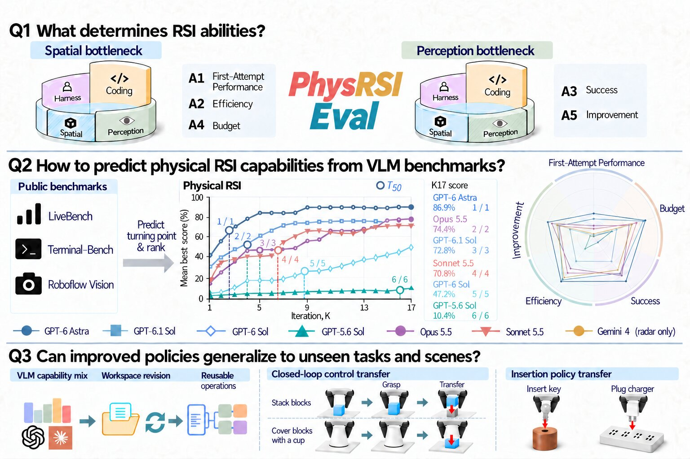
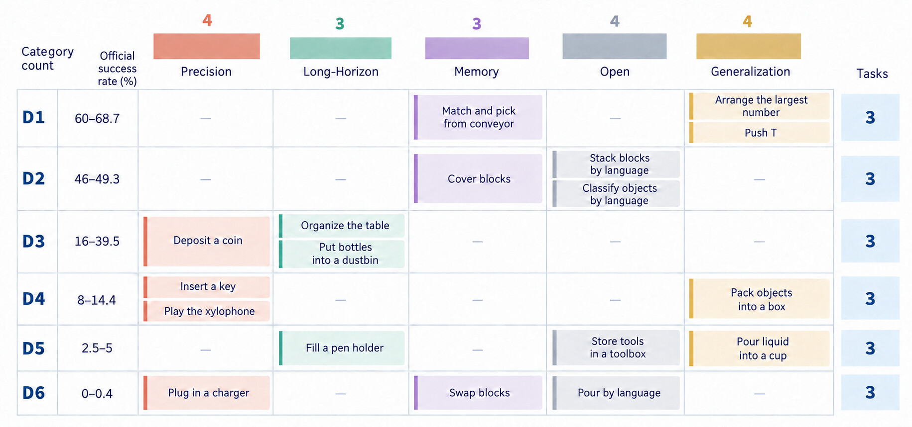
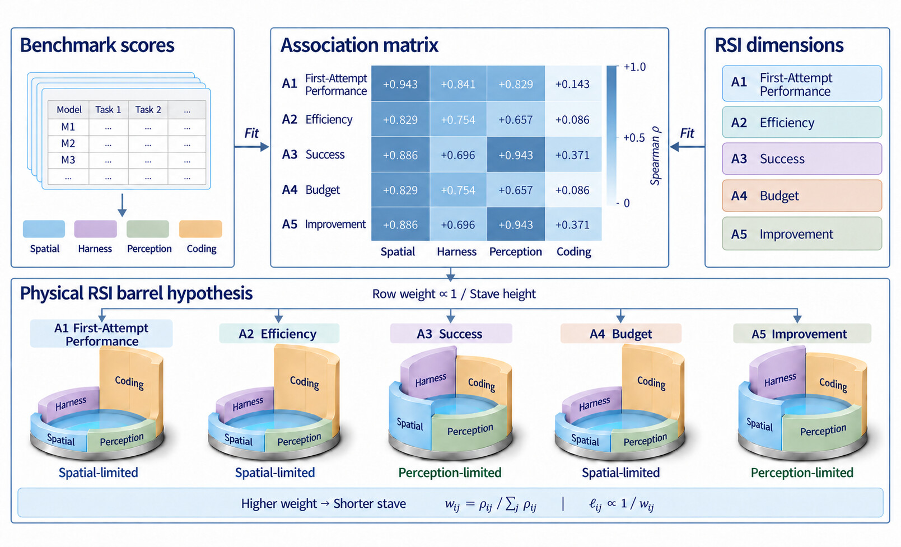
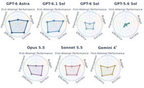
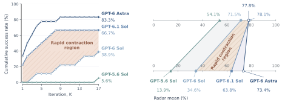
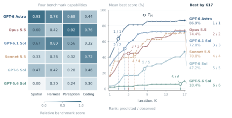
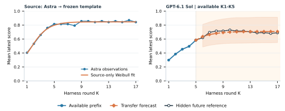
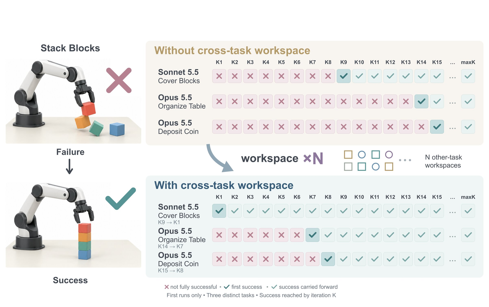
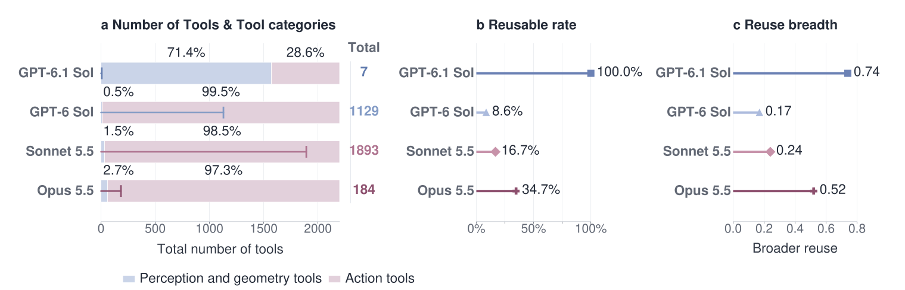

# 大模型直接当机器人策略，自我进化的能力从哪来？

> 银河通用团队发布 PhysRSI-Eval：用五个维度刻画“物理递归自我改进”，并给出一条 LLM-as-policy 的观测型 Scaling Law。

**Where is Physical RSI capability from? An Observational Scaling Law of LLM-as-policy**

Zekai Li\*, Jiayi Yu\*, Jinlu Zhang\*, Luyang Niu\*, Zekun Qi\*, Jun Zheng, Xuchuan Chen, Dairu Liu, Yintianrun Zhang, He Wang†, Li Yi† · Galbot Team

\* 共同第一作者　† 通讯作者

- 论文：https://arxiv.org/abs/2610.26848
- 主页：https://physrsi-eval.github.io/
- 代码：https://github.com/PhysRSI-Eval/PhysRSI-Eval-code



*PhysRSI-Eval 总览。Q1：物理 RSI 能力从哪来，以及“物理桶板假说”；Q2：五维量化与观测型 Scaling，T50 为半程增益轮次；Q3：改进是过拟合还是泛化。*

前沿大模型已经可以直接为机器人生成动作。更进一步，它们还能在一次次试错中改写技能、编写代码、制作工具，让自己的操作水平越来越高。模型权重不变，进步全部来自与物理世界的交互和自我修订。我们把这个过程称为**物理递归自我改进（Physical Recursive Self-Improvement，物理 RSI）**。

这篇工作不再只是展示“大模型能做到什么”，而是追问三个更基础的问题：

- **Q1**　物理 RSI 的能力来自哪里？
- **Q2**　如何量化物理 RSI？它遵循怎样的 Scaling Law？
- **Q3**　模型的进步是对练习场景的过拟合，还是可迁移的泛化？

## 基准：一个受控的物理试错闭环

| 18 | K0+17 | 5 | 6+1 |
|:-:|:-:|:-:|:-:|
| 个 RoboDojo 机器人操作任务 | 首次尝试 + 17 轮自我改进 | 个物理 RSI 评价维度 | 个被测系统（Gemini 4 单独测 10 个任务） |

PhysRSI-Eval 把每个任务拆成两个阶段，共用同一套接口。**评估阶段（K0）**：模型在没有任何积累的情况下，通过共享工具完成一次上下文内尝试。**优化阶段（K1–K17）**：模型拥有一个持久化的工作区，里面存放它自己写的技能、工具、策略和记忆。每一轮先执行并由任务原生判定打分，再在机器人动作关闭的情况下修订工作区，然后提交进入下一轮，直到首次成功或用完轮次预算。


*两阶段、同一接口。左：评估（K0），无工作区的单次尝试；右：优化（K1–KH），每轮从持久化工作区出发，原生判分、离线修订、提交。*

任务按 RoboDojo 官方成功率分为 D1（最容易）到 D6（最难）六个难度层，每层选 3 个，覆盖 RoboDojo 全部五个官方任务类别。被测系统包括 GPT-6 Astra、GPT-6.1 Sol、GPT-6 Sol、GPT-5.6 Sol、Claude Opus 5.5、Claude Sonnet 5.5，另有 Gemini 4 在 10 个任务上单独评测。



*难度均衡的任务采样：每个难度层 3 个任务，从 D1 到 D6。*

只看最终得分无法刻画自我改进：它说不清进步发生在什么时候、花了多少交互，也分不清是真的学会了还是多试几次碰上了。为此论文提出**五维指标**：

| 维度 | 名称 | 衡量什么 |
|---|---|---|
| A1 | 首次尝试表现 | 不经任何改进时的起点有多高 |
| A2 | 效率 | 增益来得有多早 |
| A3 | 成功 | 最终能达到多高的得分 |
| A4 | 预算 | 节省了多少物理交互 |
| A5 | 改进 | 能否从失败中恢复过来 |

## Q1　物理 RSI 的能力从哪来？

论文把 17 个公开基准归为四组能力：空间推理（Spatial）、智能体框架使用（Harness）、感知（Perception）和编程（Coding），再计算它们与五个维度在六个系统上的秩相关。

- **空间推理**与首次尝试表现（A1）的相关最强，ρ = **0.94**；与效率（A2）、预算（A4）也达到 0.83。
- **感知**与成功（A3）、改进（A5）的相关最强，ρ = **0.94**。
- **编程**与每个维度的相关都最弱，ρ ≤ 0.37。



*能力关联与桶板假说。矩阵为六个系统在 18 个任务上的探索性秩相关；每只木桶代表一个 RSI 维度，桶板高度示意该维度的潜在能力瓶颈。*

> **物理桶板假说（Physical Barrel Hypothesis）**
> 自我改进的不同方面，可能受不同能力的制约：开局好靠空间推理，读懂失败、从失败中恢复靠感知。编程能力再强，也不一定能补上别处的短板。

作者强调，这些关联提示的是候选瓶颈，并不构成因果结论。

## Q2　如何量化物理 RSI 与它的 Scaling Law？

### 得分高、涨得快、花得少，三者可以分离

五维画像把这些差异摆到了台面上。例如 Claude Opus 5.5 的最终成功分高于 GPT-6.1 Sol（0.744 对 0.703），但效率（0.609 对 0.822）和预算（0.579 对 0.808）明显落后。最终得分更高，并不代表进步更早，也不代表交互更省。

| 系统 | 任务数 | A1 首次尝试 | A2 效率 | A3 成功 | A4 预算 | A5 改进 |
|---|--:|--:|--:|--:|--:|--:|
| GPT-6 Astra | 18 | **0.368** | **0.859** | **0.851** | **0.843** | **0.750** |
| GPT-6.1 Sol | 18 | 0.284 | 0.822 | 0.703 | 0.808 | 0.571 |
| GPT-6 Sol | 18 | 0.031 | 0.466 | 0.472 | 0.372 | 0.389 |
| GPT-5.6 Sol | 18 | 0.012 | 0.225 | 0.104 | 0.301 | 0.056 |
| Claude Opus 5.5 | 18 | 0.177 | 0.609 | 0.744 | 0.579 | 0.688 |
| Claude Sonnet 5.5 | 18 | 0.124 | 0.695 | 0.701 | 0.698 | 0.563 |
| Gemini 4\* | 10 | 0.050 | 0.783 | 0.635 | 0.624 | 0.600 |

*五维画像（K0 分数为每任务三次运行的均值）。\*Gemini 4 仅在 10 个任务上评测，每任务一次 K0 运行。*



*七个系统的五维画像，按论文原图绘制。*

### 公开榜单上的差距，在物理世界里会被放大

四个 GPT 系统在公开基准上的平均分只相差 24 分，五维物理画像的均值却相差 **59.5** 分。GPT-5.6 Sol 在整整 16 轮里累计成功几乎为零。



*左：改进过程中的累计成功，阴影为 GPT-6.1 Sol 与 GPT-6 Sol 之间的差距；右：17 个公开基准的平均分与 100×(A1+…+A5)/5 的对比。*

### 观测型 Scaling：能涨多高，多早能涨？

沿用 observational scaling 的思路，论文用 17 个公开基准构建每个系统的四维能力画像，每次留出一对系统，用其余四个预测它们的排名。结果显示，公开能力画像复现了两项观测排序：K17 时达到的最好得分，以及半程增益轮次 T50（最好均分首次达到其 K1–K17 总增益一半的轮次）。



*左：各系统由 17 个公开基准得到的四维能力画像；右：18 个任务上逐轮最好均分。标注为“预测排名 / 观测排名”，圆圈处为 T50。*

### 前几轮的物理反馈，能预测后面多少？

以 GPT-6 Astra 的改进曲线拟合一个 Weibull 模板，只用 GPT-6.1 Sol 的 K1–K5 做校准，就能预测它 K6–K17 的走势，平均绝对误差 **0.019**；作为对照，直接沿用最后一个观测值的误差是 0.112。



*左：Astra 的均分与拟合的 Weibull 模板；右：仅给定 K1–K5 时对 GPT-6.1 Sol 后续轮次的预测，阴影为 90% 配对任务 bootstrap 区间。*

## Q3　是过拟合，还是泛化？

分数上升本身回答不了这个问题。论文设计了三组干预：去掉历史、在没见过的布局上冻结工作区测试、把工作区迁移到别的任务。

- **积累的经验确实有用。**在 Astra 的 6 任务消融中（每轮更换布局），后期轮次成功率在完整闭环下为 41.7%，去掉历史后降到 **8.3%**。
- **冻结的工作区在新布局上依然管用。**K6 之后停止修订、也不给反馈，只用工作区文件在 5 个未见布局上测试，60 次中成功 25 次（41.7%）。在固定布局上练出来的工作区，换到新布局成功率为 45.0%，在原布局上则是 88%，说明场景特化同样存在。
- **经验可以跨任务复用。**用其他任务汇总的工作区初始化后，三个案例的首次成功都大幅提前：Sonnet 5.5 的 Cover Blocks 从 K9 提前到 **K1**，Opus 5.5 的 Organize Table 从 K14 到 K7，Deposit Coin 从 K15 到 K8。



*跨任务工作区迁移。上：在 K6 或更晚才首次成功的原始轨迹；下：用其他任务汇总的工作区初始化后的轨迹。*

经验沉淀在哪里？Sonnet 5.5 和 Opus 5.5 会把控制逻辑写进自己编写的工具，后期轮次中超过 **96%** 的动作由这些工具生成。其中 Opus 复用的工具箱最广，工具谱系复用率为 0.347，Sonnet 为 0.167，GPT-6 Sol 为 0.086。



*工具库与复用。(a) 工具总数及感知/几何类与动作类工具占比；(b) 在后续轮次被复用的工具谱系比例；(c) 复用广度。*

这些结果表明，场景特化的适应与可复用的经验可以同时存在。

## 结语

PhysRSI-Eval 在固定交互预算下，系统研究了物理 RSI 的来源、度量、Scaling 与泛化。能开好局的能力，未必是能持续进步的能力；高分、早涨、省交互也未必同时出现。理解物理 RSI，既要量化智能体如何进步，也要看清它在进步中留下了什么。

作者也说明了当前工作的边界：主实验覆盖六个系统、每任务一条改进链；能力瓶颈与增益时机的预测仍是待检验的假设；消融与冻结测试只覆盖 Astra 和 6 个任务，跨任务结果来自 3 个案例。

欢迎阅读论文、访问项目主页和代码仓库：

- 论文：https://arxiv.org/abs/2610.26848
- 主页：https://physrsi-eval.github.io/
- 代码：https://github.com/PhysRSI-Eval/PhysRSI-Eval-code

---

## 发稿素材（不属于正文）

**备选标题**

1. 大模型直接当机器人策略，自我进化的能力从哪来？
2. 编程强不等于学得快：PhysRSI-Eval 揭示机器人自我改进的“桶板效应”
3. 公开榜单差 24 分，物理世界差 59.5 分：大模型机器人自我进化的观测型 Scaling Law
4. 银河通用发布 PhysRSI-Eval：用五个维度量化机器人“自我进化”

**短文案（朋友圈 / 微博 / 小红书）**

> 大模型直接控制机器人，还能边试边改、越做越好，这种“物理自我进化”的能力从哪来？我们提出 PhysRSI-Eval，在 18 个操作任务上用五个维度刻画 7 个前沿模型：开局靠空间推理，恢复靠感知，编程强不一定学得快。公开能力还能预测谁涨得更早、更高。论文 arxiv.org/abs/2610.26848　主页 physrsi-eval.github.io

**引用**

```bibtex
@misc{li2026physicalrsicapabilityfrom,
  title={Where is Physical RSI capability from? An Observational Scaling Law of LLM-as-policy},
  author={Zekai Li and Jiayi Yu and Jinlu Zhang and Luyang Niu and Zekun Qi and Jun Zheng and Xuchuan Chen and Dairu Liu and Yintianrun Zhang and He Wang and Li Yi},
  year={2026},
  eprint={2610.26848},
  archivePrefix={arXiv},
  primaryClass={cs.RO},
  url={https://arxiv.org/abs/2610.26848}
}
```
