# PhysRSI-Eval 揭示 LLM-as-Policy 自我改进的“桶板效应”：Coding 能力并非最重要

> 让大模型直接控制机器人，并在 17 轮试错中自己改代码、写工具、记笔记。能开好局靠空间推理，能从失败中爬起来靠感知；编程能力与开局、效率两个维度的相关最弱。

**Where is Physical RSI capability from? An Observational Scaling Law of LLM-as-policy**
Zekai Li\*, Jiayi Yu\*, Jinlu Zhang\*, Luyang Niu\*, Zekun Qi\*, Jun Zheng, Xuchuan Chen, Dairu Liu, Yintianrun Zhang, He Wang†, Li Yi† · Galbot Team（\* 共同第一作者　† 通讯作者）

论文 https://arxiv.org/abs/2610.26848 ｜ 主页 https://physrsi-eval.github.io/ ｜ 代码 https://github.com/PhysRSI-Eval/PhysRSI-Eval-code

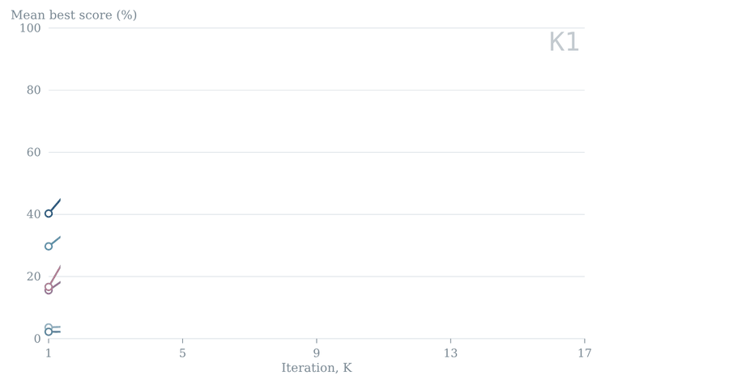

*17 轮自我改进，逐轮回放。实线为到第 k 轮为止的最好均分，圆圈为半程增益轮次 T50（相邻轮间插值）。`论文 图 7`*

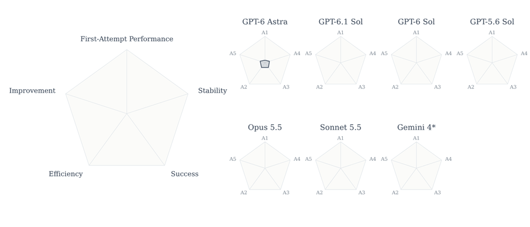

*七个系统的五维画像：先逐个绘制，再叠加对比。`论文 图 5 · 表 1`*

## 四个发现

| | 发现 | 出处 |
|:-:|---|---|
| **ρ = 0.94** | 空间推理决定开局，感知决定能否达到并保住高分；Coding 与首次尝试、效率的相关最弱（ρ ≤ 0.14） | §4.1 · 图 4 |
| **24 → 57.9** | 四个 GPT 系统的公开榜单均分只差 24 分，物理五维均分却差 57.9 分 | §5.1 · 图 6 |
| **MAE 0.019** | 公开能力可以预测谁涨得高、涨得早；只看前 5 轮，就能预测之后 12 轮的走势 | §5.2–5.3 · 图 7–8 |
| **0/26 → 3/13** | 经验可以跨模型迁移：GPT-6 Sol 读取 Astra 的工作区后单轮解出 3 个任务，空工作区一个也解不出 | §6.3 |

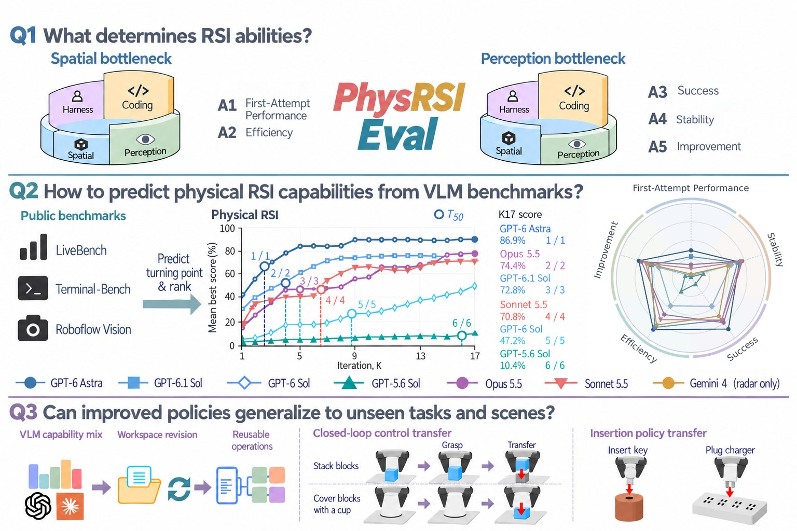

*PhysRSI-Eval 总览：Q1 能力从哪来；Q2 如何量化与预测；Q3 是过拟合还是泛化。`论文 图 1`*

## 什么是物理 RSI

模型权重冻结，智能体在每轮真实交互后，自己修改持久化工作区里的技能、工具、策略和记忆，直到首次成功或用完 17 轮预算。18 个 RoboDojo 任务，五个维度分别衡量：首次尝试得分（A1）、增益出现得多早（A2）、主要增益之后保持的得分水平（A3）、轮间得分变化中净增益所占的比例，即进步能否稳住（A4）、到 K17 补上的 K1 得分差距比例（A5）。`§3 · 图 1–3`

| Stack Blocks · GPT-6 Astra · K1 成功 | Cover Blocks · Sonnet 5.5 · K1（迁移）成功 | Plug In Charger · Sonnet 5.5 · K7 成功 | Insert Key · Sonnet 5.5 · K1 得分 0.15 |
|:-:|:-:|:-:|:-:|
| [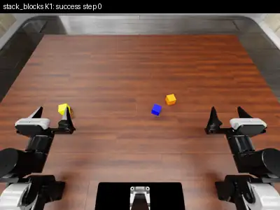](media/stack_blocks_K1_astra_success.mp4) | [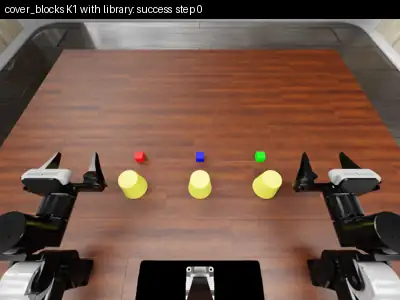](media/cover_blocks_K1_transfer_success.mp4) | [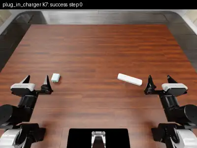](media/plug_in_charger_K7_success.mp4) | [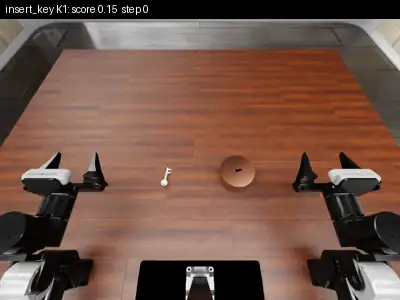](media/insert_key_K1_partial.mp4) |

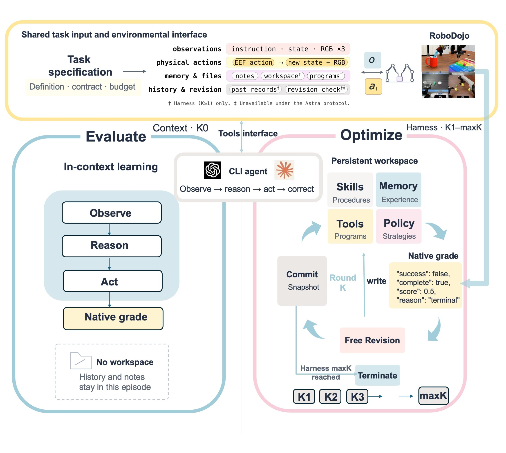

*两阶段、同一接口：K0 无工作区单次尝试；K1 起每轮从持久化工作区出发，执行、判分、离线修订、提交。`论文 图 2`*

## Q1　桶板效应：Coding 并非最重要

> *“Sonnet 5.5 has the second-highest Coding profile (0.72, versus 0.44 for GPT-6 Astra), yet its first-attempt score is a third of Astra's (0.124 versus 0.368) and it solves 11 of the 18 tasks, versus 15.”* — 论文 §4.1
>
> Sonnet 5.5 的编程画像排第二（0.72，Astra 为 0.44），首次尝试得分却只有 Astra 的三分之一，解出 11 个任务，Astra 解出 15 个。

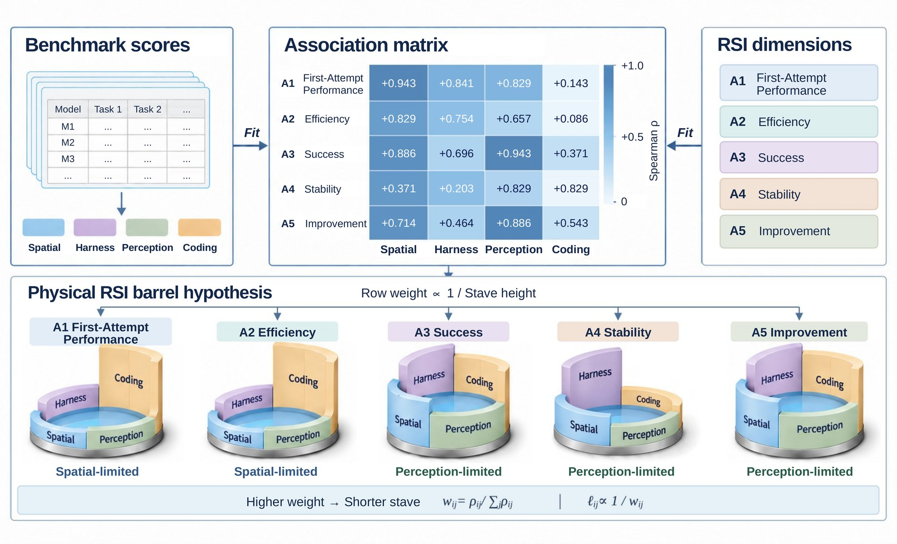

*空间推理与首次尝试（A1）ρ = 0.94；感知与成功（A3）、改进（A5）ρ = 0.94、0.89；Coding 与首次尝试、效率 ρ ≤ 0.14，与稳定性（A4）ρ = 0.83，和感知并列。`论文 图 4`*

> *“Its weak associations with A1 and A2 do not imply that coding is unnecessary, since all systems use code here.”* — 论文 §4.2
>
> Coding 相关弱，不代表不需要它：所有系统都在写代码，只是短板不在这里。

## Q2　高分、早涨、稳住，三者未必同时出现

闭源模型不公开参数量和训练算力，经典 Scaling Law 无从下手。论文改用公开基准分数，聚合成空间推理、感知、编程、工具使用四个能力因子，作为可观测的替代。`§1`

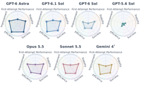

*七个系统的五维画像。Opus 5.5 的成功（**0.744** vs 0.703）、改进（**0.697** vs 0.557）和稳定性（**0.721** vs 0.656）都高于 GPT-6.1 Sol，效率却落后（0.609 vs **0.822**）。`§5.1 · 图 5 · 表 1`*

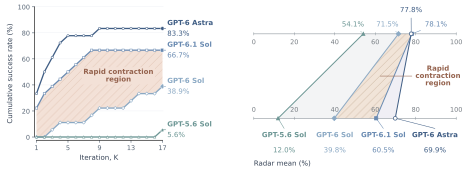

*公开榜单均分 54.1–78.1（差 24 分），物理五维均分 12.0–69.9（差 57.9 分）。从 GPT-6.1 Sol 到 GPT-6 Sol 是“急剧收缩区”：公开均分只降 6.6 分，物理均分降 20.7 分。GPT-5.6 Sol 连续 16 轮累计成功接近零。`§5.1 · 图 6`*

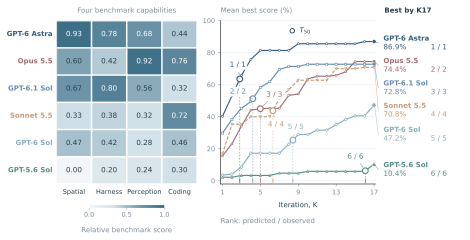

*四个能力画像（按名次归一化）的等权平均复现了 K17 最好得分的排序；用其余四个系统拟合、预测留出的两个系统，T50 的两两先后全部预测正确。直接用公开榜单原始均分，前三名会排错。`§5.2 · 图 7`*

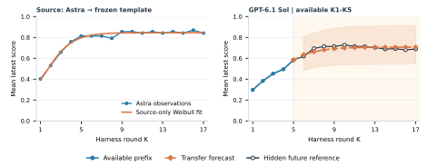

*借用 Astra 的曲线形状，只用 GPT-6.1 Sol 的 K1–K5 校准，预测 K6–K17 的平均绝对误差为 **0.019**，直接沿用最后观测值为 0.112。`§5.3 · 图 8`*

## Q3　不只是过拟合：经验可以带走

| Cover Blocks · K1 · 空工作区：失败（800/800 步） | Cover Blocks · K1 · 借用 Stack Blocks 的例程：成功（501 步） |
|:-:|:-:|
| [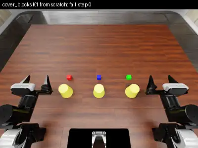](media/cover_blocks_K1_scratch_fail.mp4) |  |

- 去掉历史，后期成功率从 41.7% 降到 **8.3%**。`§6.1 · 附录表 8`
- 停止修订后，冻结的工作区在 5 个未见布局上仍成功 **25/60**。固定布局练出的工作区回到原布局成功 14/16，换到新布局降到 22/40：有记住场景的成分，也有能带走的经验。`§6.2 · 附录表 10`
- 跨模型：GPT-6 Sol 读取 Astra 的最终工作区，单轮解出 **3/13**，空工作区为 0/26（*p* = 0.031）；成功轮次没有照抄坐标，迁移的是做法而不是轨迹。`§6.3`
- 跨任务迁移让首次成功提前：K9→K1、K14→K7、K15→K8。`§6.4 · 图 9`

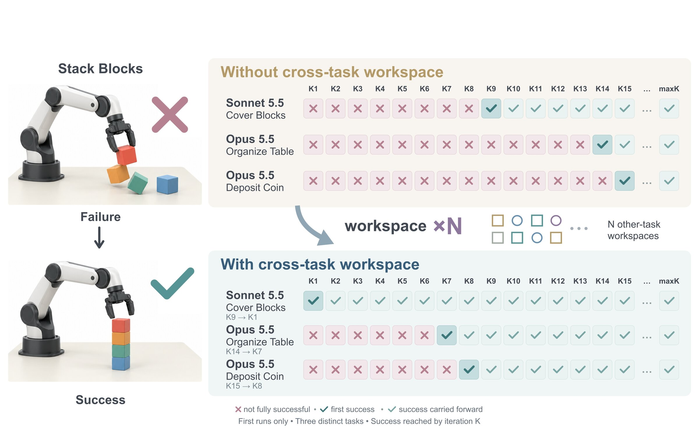

*上：原始自我改进轨迹；下：用其他任务汇总的工作区初始化后的轨迹。`论文 图 9`*

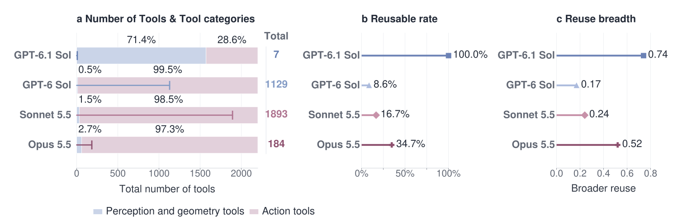

*Sonnet 5.5 与 Opus 5.5 后期超过 96% 的动作由自己写的工具生成；Opus 的工具复用面最广（谱系复用率 0.347）。`§6.4 · 图 10`*

## 一句话

能开好局的能力，不等于能持续进步的能力。理解物理 RSI，既要看智能体如何进步，也要看它在进步中留下了什么。`§8`

局限：所有任务都在 RoboDojo 仿真中运行，“物理”指经判分的机器人–环境交互，而非真机部署；评测覆盖六个闭源系统；RSI 取狭义，模型权重不变，只有智能体的工作区在变。`§7`

论文 https://arxiv.org/abs/2610.26848 ｜ 主页 https://physrsi-eval.github.io/ ｜ 代码 https://github.com/PhysRSI-Eval/PhysRSI-Eval-code
