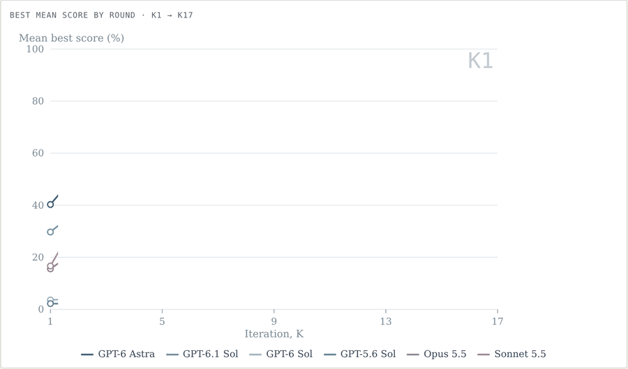
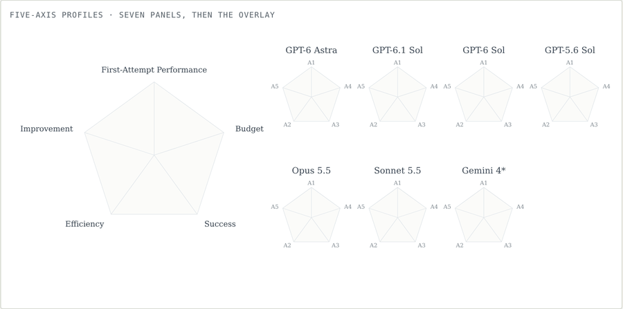
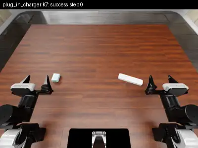
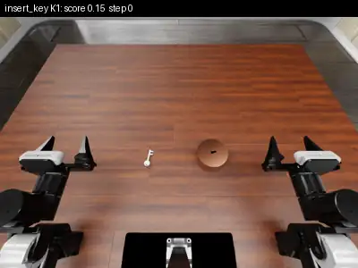
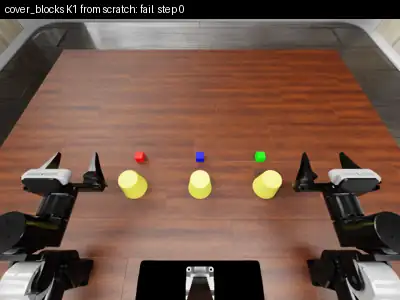

# PhysRSI-Eval 揭示 VLM-as-Policy 自我改进的“桶板效应”：Coding 能力并非最重要

> 让大模型直接控制机器人，并在 17 轮试错中自己改代码、写工具、记笔记。能开好局靠空间推理，能从失败中爬起来靠感知；编程能力与五个评价维度的相关反而最弱。

**Where is Physical RSI capability from? An Observational Scaling Law of LLM-as-policy**
Zekai Li\*, Jiayi Yu\*, Jinlu Zhang\*, Luyang Niu\*, Zekun Qi\*, Jun Zheng, Xuchuan Chen, Dairu Liu, Yintianrun Zhang, He Wang†, Li Yi† · Galbot Team（\* 共同第一作者　† 通讯作者）

论文 https://arxiv.org/abs/2610.26848 ｜ 主页 https://physrsi-eval.github.io/ ｜ 代码 https://github.com/PhysRSI-Eval/PhysRSI-Eval-code

<p align="center"></p>

*17 轮自我改进，逐轮回放。实线为到第 k 轮为止的最好均分，圆圈为半程增益轮次 T50。`论文 图 7`*

<p align="center"></p>

*七个系统的五维画像：先逐个绘制，再叠加对比。`论文 图 5 · 表 1`*

## 四个发现

| | 发现 | 出处 |
|:-:|---|---|
| **ρ = 0.94** | 空间推理决定开局，感知决定能否从失败中恢复；Coding 与五个维度的相关都最弱（ρ ≤ 0.37） | §4.1 · 图 4 |
| **24 → 59.5** | 四个 GPT 系统的公开榜单均分只差 24 分，物理五维均分却差 59.5 分 | §5.1 · 图 6 |
| **MAE 0.019** | 公开能力可以预测谁涨得高、涨得早；只看前 5 轮，就能预测之后 12 轮的走势 | §5.2–5.3 · 图 7–8 |
| **K9 → K1** | 经验可以迁移：借用其他任务沉淀的工作区，首次成功从第 9 轮提前到第 1 轮 | §6.3 · 图 9 |

<p align="center"></p>

*PhysRSI-Eval 总览：Q1 能力从哪来；Q2 如何量化与预测；Q3 是过拟合还是泛化。`论文 图 1`*

## 什么是物理 RSI

模型权重冻结，智能体在每轮真实交互后，自己修改持久化工作区里的技能、工具、策略和记忆，直到首次成功或用完 17 轮预算。18 个 RoboDojo 任务，五个维度分别衡量：首次尝试得分（A1）、增益出现得多早（A2）、达到的最好得分（A3）、首次成功前省下的物理预算（A4）、首轮失败后来被解决的比例（A5）。`§3 · 图 1–3`

| Stack Blocks · GPT-6 Astra · K1 成功 | Cover Blocks · Sonnet 5.5 · K1（迁移）成功 | Plug In Charger · Sonnet 5.5 · K7 成功 | Insert Key · Sonnet 5.5 · K1 得分 0.15 |
|:-:|:-:|:-:|:-:|
| [](media/stack_blocks_K1_astra_success.mp4) | [](media/cover_blocks_K1_transfer_success.mp4) | [](media/plug_in_charger_K7_success.mp4) | [](media/insert_key_K1_partial.mp4) |

<p align="center"></p>

*两阶段、同一接口：K0 无工作区单次尝试；K1 起每轮从持久化工作区出发，执行、判分、离线修订、提交。`论文 图 2`*

## Q1　桶板效应：Coding 并非最重要

> *“GPT-5.6 Sol exceeds GPT-6 Astra on LiveBench code generation and completion, yet solves one of the 18 tasks, whereas Astra solves 15.”* — 论文 §4.1
>
> 编程分数更高的 GPT-5.6 Sol 只解出 1 个任务，GPT-6 Astra 解出 15 个。

<p align="center"></p>

*空间推理与首次尝试（A1）ρ = 0.94；感知与成功（A3）、改进（A5）ρ = 0.94；Coding 与所有维度 ρ ≤ 0.37。`论文 图 4`*

> *“Its weak associations do not imply that coding is unnecessary; all systems use code here.”* — 论文 §4.2
>
> Coding 相关弱，不代表不需要它：所有系统都在写代码，只是短板不在这里。

## Q2　高分、早涨、省交互，三者可以分离

闭源模型不公开参数量和训练算力，经典 Scaling Law 无从下手。论文改用公开基准分数，聚合成空间推理、感知、编程、工具使用四个能力因子，作为可观测的替代。`§1`

<p align="center"></p>

*七个系统的五维画像。Opus 5.5 的成功分高于 GPT-6.1 Sol（**0.744** vs 0.703），效率（0.609 vs **0.822**）和预算（0.579 vs **0.808**）却落后。`§5.1 · 图 5 · 表 1`*

<p align="center"></p>

*公开榜单均分 54.1–78.1（差 24 分），物理五维均分 13.9–73.4（差 59.5 分）；GPT-5.6 Sol 连续 16 轮累计成功接近零。`§5.1 · 图 6`*

<p align="center"></p>

*用其余四个系统拟合、预测留出的两个系统：K17 最好得分与 T50 的排序全部预测正确。`§5.2 · 图 7`*

<p align="center"></p>

*借用 Astra 的曲线形状，只用 GPT-6.1 Sol 的 K1–K5 校准，预测 K6–K17 的平均绝对误差为 **0.019**，直接沿用最后观测值为 0.112。`§5.3 · 图 8`*

## Q3　不只是过拟合：经验可以带走

| Cover Blocks · K1 · 空工作区：失败（800/800 步） | Cover Blocks · K1 · 借用 Stack Blocks 的例程：成功（501 步） |
|:-:|:-:|
| [](media/cover_blocks_K1_scratch_fail.mp4) | [](media/cover_blocks_K1_transfer_success.mp4) |

- 去掉历史，后期成功率从 41.7% 降到 **8.3%**。`§6.1 · 表 8`
- 停止修订后，冻结的工作区在 5 个未见布局上仍成功 **25/60**。`§6.2 · 表 9`
- 跨任务迁移让首次成功提前：K9→K1、K14→K7、K15→K8。`§6.3 · 图 9`

<p align="center"></p>

*上：原始自我改进轨迹；下：用其他任务汇总的工作区初始化后的轨迹。`论文 图 9`*

<p align="center"></p>

*Sonnet 5.5 与 Opus 5.5 后期超过 96% 的动作由自己写的工具生成；Opus 的工具复用面最广（谱系复用率 0.347）。`§6.3 · 图 10`*

## 一句话

能开好局的能力，不等于能持续进步的能力。理解物理 RSI，既要看智能体如何进步，也要看它在进步中留下了什么。`§8`

局限：主实验为六个系统、每任务一条改进链；能力瓶颈与预测仍是待检验的假设；消融与冻结测试只覆盖 Astra 的 6 个任务，跨任务结果来自 3 个案例。`§7`

论文 https://arxiv.org/abs/2610.26848 ｜ 主页 https://physrsi-eval.github.io/ ｜ 代码 https://github.com/PhysRSI-Eval/PhysRSI-Eval-code

---

## 发稿素材（不属于正文）

**备选标题**

1. PhysRSI-Eval 揭示 VLM-as-Policy 自我改进的“桶板效应”：Coding 能力并非最重要
2. 编程分数更高，却只解出 1 个任务：大模型机器人自我进化的短板在哪里？
3. 公开榜单差 24 分，物理世界差 59.5 分：VLM-as-Policy 的观测型 Scaling Law

**短文案（朋友圈 / 微博 / 小红书）**

> 大模型直接控制机器人、边试边改，谁进步得最快？PhysRSI-Eval 在 18 个操作任务、17 轮自我改进中测了 7 个前沿模型：开局靠空间推理，恢复靠感知，Coding 与各项指标的相关反而最弱。arxiv.org/abs/2610.26848 ｜ physrsi-eval.github.io

**配套素材**：开头两段动图为 GIF（`anim/climb.gif`、`anim/radar.gif`），可直接上传公众号；网页版用同内容的 WebP。任务视频原文件在 `media/`。

**引用**

```bibtex
@misc{li2026physicalrsicapabilityfrom,
  title={Where is Physical RSI capability from? An Observational Scaling Law of LLM-as-policy},
  author={Zekai Li and Jiayi Yu and Jinlu Zhang and Luyang Niu and Zekun Qi and Jun Zheng and Xuchuan Chen and Dairu Liu and Yintianrun Zhang and He Wang and Li Yi},
  year={2026},
  eprint={2610.26848},
  archivePrefix={arXiv},
  primaryClass={cs.RO},
  url={https://arxiv.org/abs/2610.26848}
}
```
